# ARCH-02 — Arquitectura de software de Piedra Azul

**Universidad del Cauca — Ingeniería de Software III · 2026.2** 
**Proyecto:** Piedra Azul — sistema web de reserva y gestión de citas médicas  
**Iteración:** Segundo corte / Sprint 2  
**Contenido:** Modelo C4 y vistas UML 4+1  
**Versión:** 2.1 — revisión técnica UML de la segunda iteración 
**Fecha:** 2 de noviembre de 2026  
**Repositorio:** https://github.com/gvalen03/piedra-azul

---

## 1. Introducción y alcance

Piedra Azul es un sistema web que centraliza la gestión de pacientes, médicos y terapistas, disponibilidades, citas y controles clínicos. Para la segunda iteración se amplía el agendamiento mediante consulta de agenda, reserva autónoma, configuración de franjas, exportación de jornadas a CSV y consulta del historial de citas por documento del paciente. El sistema también requiere controles de autenticación y autorización para proteger operaciones y datos sensibles.

Este documento presenta la **arquitectura de software definida para la segunda iteración**, mediante los tres niveles del modelo C4 (contexto, contenedores y componentes relevantes) y las vistas lógica, desarrollo, procesos, física y escenarios del modelo **4+1**. Describe responsabilidades, colaboraciones, límites de confianza y decisiones tecnológicas; sus diagramas son **modelos arquitectónicos**, no sustituyen la ejecución de pruebas funcionales ni de seguridad.

La guía académica solicita utilizar **un sistema externo de autenticación basado en JWT, como Keycloak**. Para Piedra Azul se ha seleccionado **Keycloak** como proveedor de identidad de la solución, separado del backend de negocio. La API conserva la validación de los tokens y la autorización para operar sobre recursos internos. La representación de este diseño evita asociarlo a procesos de Git, fechas de integración o responsables individuales.

### 1.1. Principios de diseño

- **Separación de responsabilidades:** la presentación reside en SolidJS; las reglas de negocio y permisos, en Fastify; la persistencia, en PostgreSQL.
- **Monolito modular:** la API agrupa módulos de negocio en un solo proceso, no en microservicios independientes.
- **Autenticación centralizada:** la arquitectura de la segunda iteración utiliza Keycloak para identidad y emisión de tokens; la API verifica el acceso y comprueba la autorización del recurso.
- **Datos controlados por servidor:** los identificadores de paciente o médico vinculados a la sesión no deben aceptarse ciegamente desde el navegador.
- **Consistencia en el agendamiento:** la disponibilidad se consulta antes de reservar y se revalida al persistir para reducir asignaciones simultáneas de la misma franja.
- **Trazabilidad:** los componentes se vinculan con rutas, servicios, entidades y repositorios identificados en el proyecto.

### 1.2. Tecnologías y responsabilidades

| Elemento | Tecnología | Responsabilidad arquitectónica |
|---|---|---|
| Cliente web | SolidJS, Vite, enrutamiento SPA | Formularios, navegación, experiencia de usuario y consumo de la API |
| API de negocio | Node.js, Fastify | Validación de solicitudes, reglas de negocio, permisos y coordinación entre módulos |
| Persistencia | PostgreSQL, biblioteca `pg` | Usuarios y perfiles de negocio, citas, disponibilidades, auditoría y controles |
| Identidad | Keycloak, tokens JWT | Autenticación centralizada y suministro de información de identidad/roles |
| Seguridad de la API | Verificación JWT y controles de rol/recurso | Establecer identidad confiable antes de ejecutar operaciones protegidas |
| Eventos internos | `EventEmitter` de Node.js | Notificación de eventos de aplicación dentro del mismo proceso |

---

## 2. Arquitectura mediante el modelo C4

Los niveles C4 se leen de lo general a lo particular. El contexto delimita el sistema; los contenedores identifican unidades ejecutables o de datos; y los componentes muestran responsabilidades internas del backend. En las figuras, **Keycloak es un sistema externo de identidad**, no un módulo Fastify ni una base de datos clínica.

### 2.1. C4 nivel 1 — Diagrama de contexto

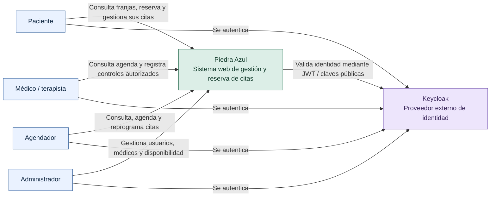

**Figura 1. Contexto de Piedra Azul.** El paciente reserva y consulta sus citas; el médico consulta su agenda y registra atención; el agendador gestiona citas; y el administrador configura usuarios y disponibilidad. El sistema se relaciona con Keycloak para el servicio de identidad. La aplicación sigue siendo responsable de proteger sus operaciones y datos clínicos.

| Actor | Necesidad principal | Control relevante |
|---|---|---|
| Paciente | Consultar franjas, reservar, confirmar/cancelar y revisar sus citas | Solo opera sobre su perfil y citas asociadas |
| Médico o terapista | Consultar agenda, registrar atención y consultar información autorizada | Acceso restringido por rol y vínculo con el profesional |
| Agendador | Consultar agendas, reservar, reprogramar y consultar pacientes | Roles y validación de las operaciones de agenda |
| Administrador | Administrar cuentas, profesionales y configuración de disponibilidad | Operaciones administrativas protegidas |

### 2.2. C4 nivel 2 — Diagrama de contenedores

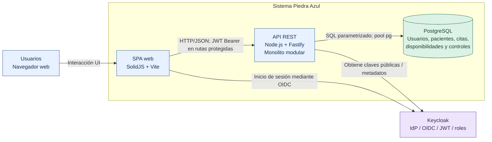

**Figura 2. Contenedores de Piedra Azul.** La SPA presenta la interfaz; la API ejecuta la lógica y expone endpoints REST; PostgreSQL almacena los datos del negocio; Keycloak actúa como proveedor externo de identidad. Los módulos del backend forman **un único monolito modular**, por lo que no deben dibujarse como servicios desplegados de forma independiente.

**Comunicación principal:** el navegador consume recursos de la API a través de HTTP/JSON y envía un token de acceso para operaciones protegidas; el backend utiliza consultas SQL parametrizadas a PostgreSQL. La autenticación externa establece una frontera de confianza adicional entre el usuario, el proveedor de identidad y la API.

### 2.3. C4 nivel 3 — Componentes principales del backend

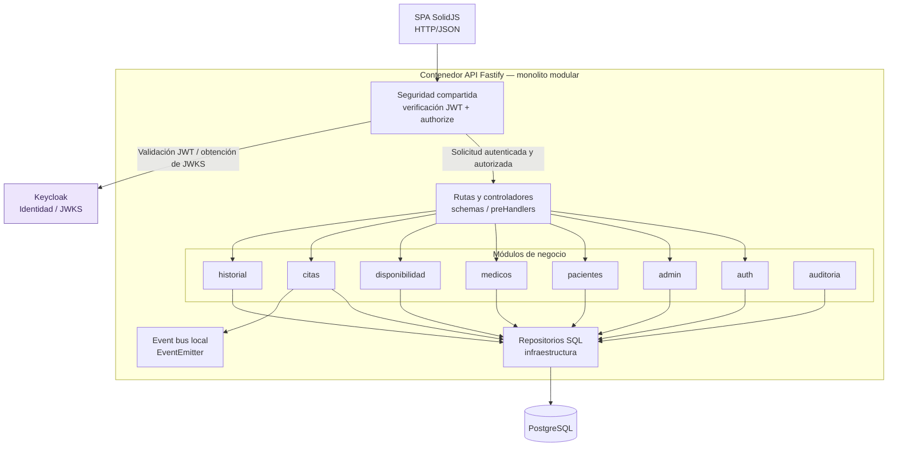

**Figura 3. Componentes del contenedor Fastify.** Las rutas y controladores reciben peticiones, los servicios coordinan reglas de aplicación, las entidades representan conceptos del dominio y los repositorios abstraen la persistencia. La seguridad y auditoría son preocupaciones transversales. Los módulos identificados son: `admin`, `auth`, `medicos`, `pacientes`, `disponibilidad`, `citas`, `historial` y `auditoria`.

La composición de los servicios, sus controladores y sus repositorios se realiza en `backend/src/app.js`. La seguridad compartida establece los permisos aplicables a cada ruta; el proveedor de identidad no reemplaza estas reglas de autorización del negocio.

### 2.4. C4 nivel 3 — Componentes del agendamiento

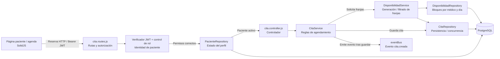

**Figura 4. Detalle de componentes para reservar citas.** La ruta protegida valida la identidad, obtiene el identificador del paciente de la sesión y verifica su estado. `CitaService` consulta franjas mediante `DisponibilidadService`, comprueba el horario y coordina la reserva a través de `CitaRepository`. La persistencia vuelve a comprobar la ocupación dentro de una operación transaccional. Esto es importante porque una franja pudo liberarse o ocuparse entre la consulta inicial y el envío de la reserva.

El módulo Citas también articula consulta de agenda, confirmación, cancelación y reprogramación. Para la segunda iteración contempla la exportación de listados de jornada a CSV. El módulo de Pacientes aporta datos de identificación y perfil necesarios para los accesos autorizados.

---

## 3. Arquitectura mediante el modelo UML 4+1

El modelo 4+1 organiza el sistema desde cuatro perspectivas complementarias y una vista de escenarios que las relaciona.

| Vista | Pregunta que responde | Representación |
|---|---|---|
| Lógica | ¿Qué entidades y conceptos conforman el dominio? | Modelo de clases |
| Desarrollo | ¿Cómo se organiza el código y cuáles son las dependencias? | Paquetes y módulos |
| Procesos | ¿Cómo colaboran los elementos durante una operación? | Diagrama de secuencia |
| Física | ¿Cómo se distribuyen los procesos y servicios de la solución? | Despliegue lógico |
| +1 Escenarios | ¿Qué casos de uso justifican la arquitectura? | Casos de uso y secuencias |

### 3.1. Vista lógica — Modelo de clases

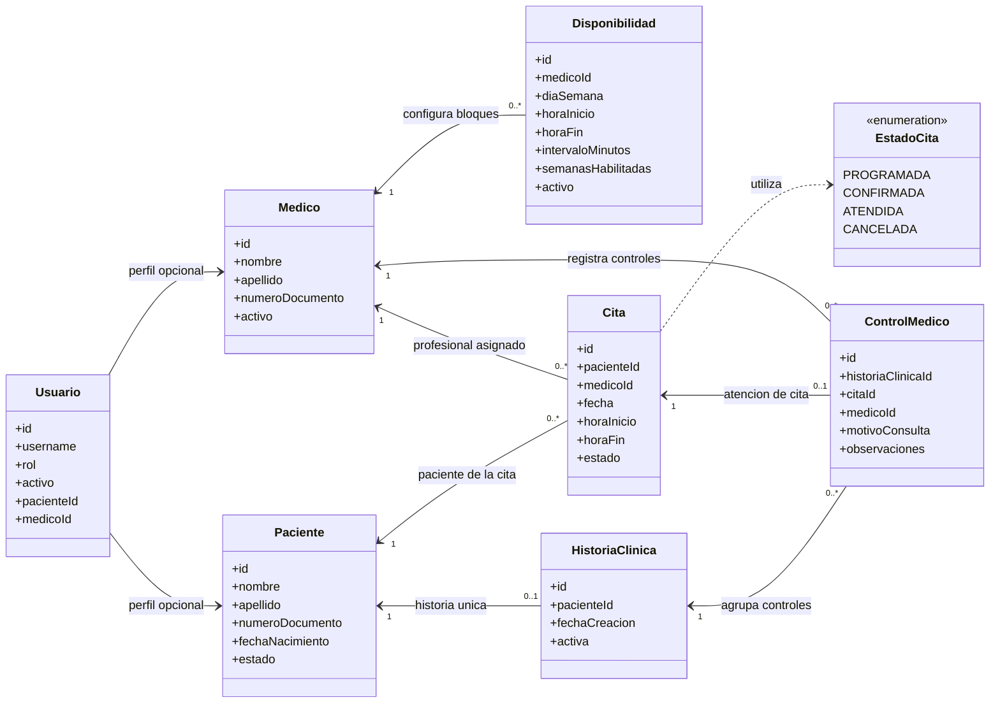

**Figura 5. Entidades principales del dominio.** `Usuario` representa la cuenta y su rol; `Paciente` y `Medico` los perfiles del negocio; `Disponibilidad` configura días, horas y duración de franjas; `Cita` relaciona paciente, profesional y horario; e `HistoriaClinica` y `ControlMedico` modelan la información de la atención. Los estados de cita son `PROGRAMADA`, `CONFIRMADA`, `ATENDIDA` y `CANCELADA`.

Las asociaciones combinan el modelo de dominio con reglas aplicadas por los repositorios. Una cita pertenece a un paciente y a un profesional; un profesional puede tener varias disponibilidades y citas. Cada paciente mantiene como máximo una historia clínica en el esquema utilizado por `HistorialRepository`, que emplea `ON CONFLICT (paciente_id)`. Cada cita admite como máximo un control médico, comprobado al registrar una atención. Los vínculos de `Usuario` con perfiles de paciente o profesional son opcionales y se muestran sin fijar multiplicidades que no se hayan contrastado con todas las restricciones de la base de datos. Los atributos se sintetizan para que el diagrama sea legible.

**Invariantes principales del negocio:**

1. Una franja debe tener horas válidas y ordenadas; el intervalo debe ser positivo y caber en el bloque.
2. Las reservas no pueden utilizar una franja fuera del período habilitado ni una franja ocupada.
3. La consulta y modificación de citas propias dependen de la identidad autenticada y de su perfil interno.
4. El registro de atención médica exige validaciones de vínculo y campos mínimos del control.

### 3.2. Vista de desarrollo — Organización de módulos

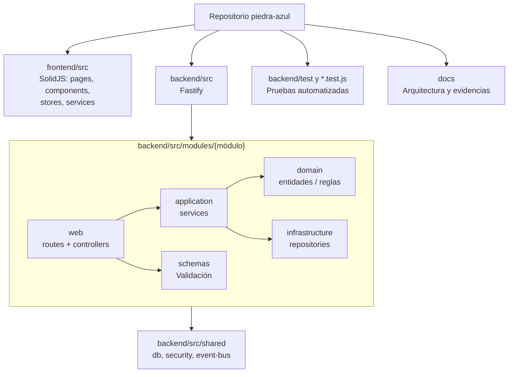

**Figura 6. Organización de desarrollo.** Esta representación sintetiza la vista de paquetes del código (la fuente UML formal se ofrece en el anexo). El repositorio contiene una aplicación frontend y una aplicación backend. En el backend, el patrón modular separa `web` (rutas/controladores), `application` (casos de uso/servicios), `domain` (entidades y conceptos), `infrastructure` (repositorios) y `schemas` (validación de solicitudes). Las dependencias concretas se componen al iniciar Fastify.

Esta separación favorece pruebas con dependencias sustituidas, mantenimiento localizado y una interfaz desacoplada de la persistencia. **No implica** que todas las operaciones adopten idéntica estructura ni que existan servicios de red por módulo.

### 3.3. Vista de procesos — Reserva de una cita

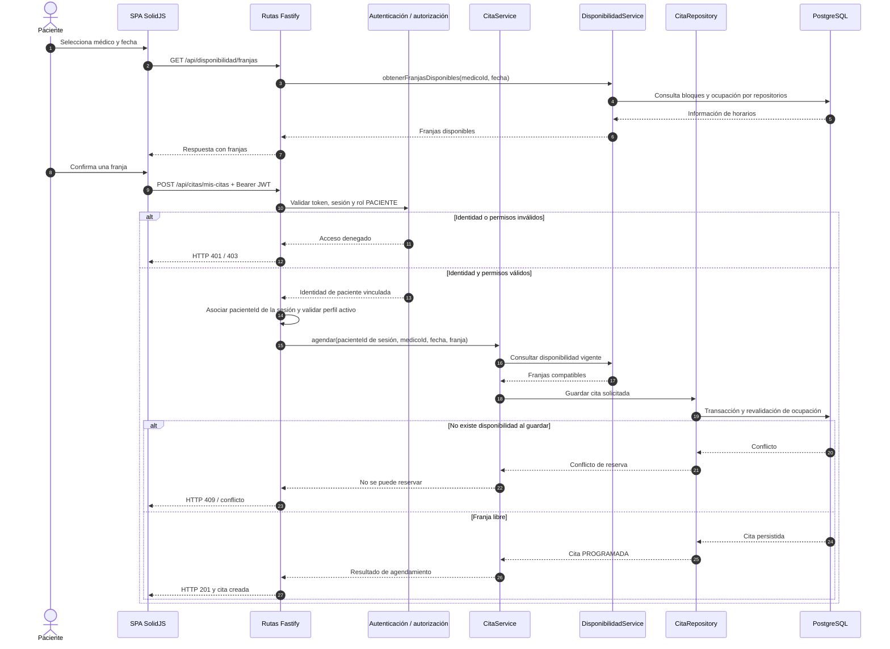

**Figura 7. Secuencia de reserva autónoma.** El paciente consulta horarios y envía la selección. Antes de ejecutar el caso de uso se valida la identidad y autorización; la API obtiene la identidad del paciente a partir de la sesión y el backend revalida la disponibilidad al guardar. El tratamiento de conflictos evita asumir que una franja consultada anteriormente continúa libre.

**Responsabilidades temporales:**

- La SPA recopila fecha, profesional y franja, pero no decide permisos ni persistencia.
- Fastify aplica las reglas de acceso de cada ruta.
- Los servicios coordinan la disponibilidad y las reglas de reserva.
- Los repositorios ejecutan el acceso SQL y las operaciones transaccionales.

### 3.4. Vista física — Despliegue lógico

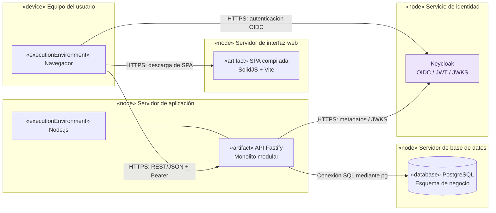

**Figura 8. Vista de despliegue lógico (representación UML mediante estereotipos).** El modelo distingue dispositivos, nodos, entornos de ejecución y artefactos: equipo del usuario, publicación de la SPA, proceso Node/Fastify, PostgreSQL y Keycloak. El anexo incorpora su fuente PlantUML para generar un diagrama UML de despliegue con notación convencional. La separación representa responsabilidades y canales de comunicación; **no prescribe** un proveedor de alojamiento concreto ni confunde un flujo de trabajo de publicación con un servicio ya operativo.

Para proteger la solución, las comunicaciones externas deben emplear HTTPS; la conexión de aplicación con PostgreSQL utiliza credenciales configuradas fuera del código; y los secretos, la configuración del realm y las direcciones de servicios deben gestionarse mediante el entorno de ejecución.

### 3.5. Vista +1 — Casos de uso y escenarios

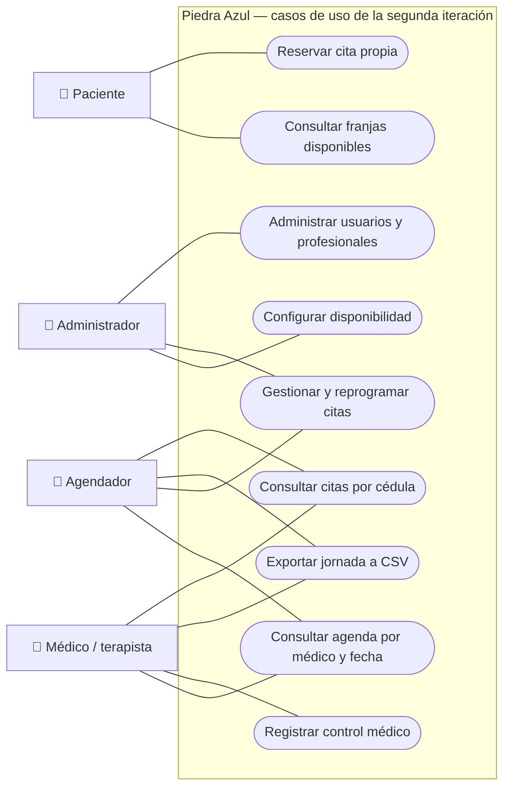

**Figura 9. Casos de uso de la segunda iteración.** El esquema Mermaid presenta actores, asociaciones y límite del sistema con una disposición equivalente a casos de uso; la fuente PlantUML del anexo permite exportarlo con notación UML convencional. El diagrama combina los recorridos clave del sistema con los cinco requisitos funcionales del corte: consulta de agendas, reserva del paciente, configuración administrativa, exportación CSV y consulta de citas por documento. Los casos de atención clínica y administración proporcionan contexto al dominio.

#### Escenario A — Configurar disponibilidad de un profesional

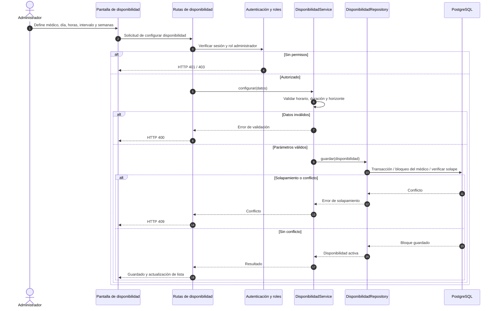

**Figura 10. Secuencia de configuración de disponibilidad.** El administrador introduce el día, el horario, el intervalo y el horizonte de semanas. La API valida su rol, el servicio comprueba los valores y el repositorio evita solapamientos mediante validaciones transaccionales. Una configuración válida permite generar las franjas que después visualiza el paciente.

#### Escenarios arquitectónicos de referencia

| Escenario | Componentes que participan | Resultado funcional esperado |
|---|---|---|
| E1. Reservar cita propia | SPA, autenticación, Citas, Disponibilidad, PostgreSQL | Registrar una cita válida para el paciente autenticado, sin doble ocupación |
| E2. Configurar disponibilidad | Administración, Disponibilidad, PostgreSQL | Crear o actualizar bloques válidos y rechazar solapamientos |
| E3. Consultar agenda médica | SPA, Citas, repositorio | Mostrar citas por profesional y fecha, con listado y cantidad |
| E4. Exportar jornada CSV | Agenda, Citas y serialización CSV | Obtener un archivo de texto compatible con hojas de cálculo |
| E5. Consultar citas por documento | Pacientes, Citas y base de datos | Localizar las citas del paciente según los permisos del actor |
| E6. Registrar control médico | Historial, validación de identidad y PostgreSQL | Asociar un control autorizado a una cita y profesional |
| E7. Autenticación y autorización | SPA, Keycloak, API Fastify y perfil interno | Validar identidad y roles; denegar acceso inválido o insuficiente |

Estos escenarios conectan las vistas arquitectónicas con las funcionalidades de la iteración. **Las pruebas de aceptación y de usabilidad pertenecen a su documentación específica** y no se deducen únicamente de los diagramas.

---

## 4. Diseño de autenticación y autorización con Keycloak

Keycloak constituye la **frontera externa de identidad** de Piedra Azul. Su responsabilidad es autenticar usuarios y emitir tokens de acceso; la API de negocio verifica las credenciales de acceso representadas por el JWT y aplica permisos propios para citas, pacientes, profesionales y controles clínicos. Esta organización evita colocar reglas de seguridad del negocio en los componentes visuales del navegador.

### 4.1. Secuencia arquitectónica de autenticación y acceso

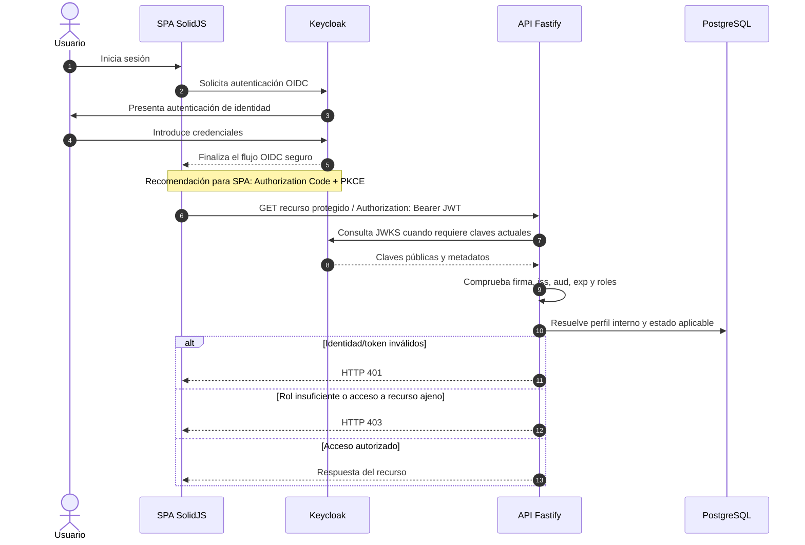

**Figura 11. Interacción entre la SPA, Keycloak y Fastify.** El esquema describe el intercambio de identidad de alto nivel. Para un cliente SPA, el flujo OIDC recomendado es Authorization Code con PKCE, sin exponer credenciales a Fastify. El token de acceso acompaña las solicitudes protegidas. La verificación de firma y los claims establece la identidad; la autorización comprueba además si el rol y el recurso solicitado son compatibles. El diagrama representa **el contrato de diseño de la segunda iteración**: no es un log de ejecución ni una demostración de pruebas realizadas.

### 4.2. Responsabilidades y controles del diseño

| Elemento | Responsabilidad |
|---|---|
| Keycloak | Autenticar a los usuarios, emitir access tokens JWT y gestionar la información de roles según la configuración del realm |
| Cliente web | Iniciar el proceso de autenticación y enviar el token de acceso a la API por un canal protegido |
| Verificador JWT de la API | Validar firma y algoritmo, emisor (`iss`), destinatario o cliente (`aud` según configuración), expiración (`exp`) y vigencia (`nbf` cuando exista) |
| Mapeo de identidad | Interpretar los claims y asociar la identidad externa al usuario o perfil interno aplicable |
| Control de autorización | Aplicar roles `ADMINISTRADOR`, `AGENDADOR`, `MEDICO_TERAPISTA` y `PACIENTE`, además de permisos por propiedad del recurso |
| Persistencia | Conservar datos de negocio, perfiles y estados; no sustituir al proveedor externo de identidad |
| Respuestas de seguridad | Responder 401 ante identidad/token no válido y 403 cuando la identidad sea válida pero carezca del permiso necesario |

**Consideración importante:** adoptar Keycloak no autoriza a mantener un mecanismo de login local como puerta alternativa sin las mismas garantías. La solución debe definir claramente qué componente autentica, cómo se interpreta cada token y dónde se toman las decisiones de autorización.

---

## 5. Decisiones arquitectónicas y compromisos

| ID | Decisión | Motivo técnico | Referencia del proyecto |
|---|---|---|---|
| DA-01 | Arquitectura **monolito modular** en Fastify | Compartir proceso y despliegue sin renunciar a límites funcionales | `backend/src/app.js` |
| DA-02 | Interfaz SPA con SolidJS y Vite | Separar navegación e interacción de los casos de uso del servidor | `frontend/src/App.jsx`, `frontend/package.json` |
| DA-03 | API REST y validación del servidor | Centralizar contratos, permisos y reglas, evitando confiar en la UI | `backend/src/modules/*/web/` |
| DA-04 | PostgreSQL como persistencia de negocio | Mantener consistencia y consultas de usuarios, horarios, citas y controles | `backend/src/shared/db/database.js` |
| DA-05 | Revalidar reservas en transacción | Reducir condiciones de carrera y horarios duplicados | `backend/src/modules/citas/infrastructure/cita.repository.js` |
| DA-06 | Seguridad centralizada con roles y recursos | Aplicar permisos también en backend, no solo al ocultar páginas | `backend/src/shared/security/authorize.js` y rutas |
| DA-07 | Keycloak como identidad externa | Cumplir el requisito de proveedor externo JWT y separar identidad de dominio | Requisito no funcional de la guía y contrato AUTH-01 |
| DA-08 | Eventos de dominio dentro del proceso | Informar acciones de citas sin convertir cada módulo en microservicio | `backend/src/shared/event-bus.js`, `CitaService` |
| DA-09 | Pruebas automatizadas con repositorios simulados | Verificar servicios y rutas sin depender siempre de una BD de prueba | Archivos `*.test.js` del backend |

### 5.1. Riesgos arquitectónicos y medidas de control

| Riesgo | Impacto posible | Medida de diseño |
|---|---|---|
| Dependencia del proveedor de identidad | Interrupción de autenticación por indisponibilidad o configuración errónea | Integración desacoplada, validación robusta de tokens y configuración segura |
| Acceso indebido por roles o identidad | Consulta o modificación de recursos de otros usuarios | Autorización en cada ruta, asociación con perfil y comprobación de propiedad |
| Concurrencia al reservar | Dos solicitudes intentan ocupar una misma franja | Revalidación bajo transacción y bloqueos apropiados |
| Exposición de datos de salud | Acceso a controles o datos personales sin permiso | Control de acceso en el backend, datos mínimos y manejo responsable de evidencias |
| Acoplamiento entre módulos | Dificultad para evolucionar funciones sin regresiones | Separación web/aplicación/dominio/infraestructura y pruebas automatizadas |
| Configuración insegura | Divulgación de secretos o tokens, errores de conexión | Variables de entorno, HTTPS, manejo de tokens y configuración fuera del repositorio |

---

## 6. Trazabilidad técnica

La tabla vincula los elementos arquitectónicos con ubicaciones concretas del proyecto y con el requisito de identidad externa. Las rutas permiten revisar las decisiones del diseño; los diagramas no dependen de que las referencias estén asociadas a un PR específico.

| Elemento | Archivo o fuente de referencia | Relación con el modelo |
|---|---|---|
| SPA y vistas por rol | `frontend/src/App.jsx`; `frontend/package.json` | Contenedor de presentación y navegación |
| Cliente de API | `frontend/src/services/api.js`; `frontend/src/stores/auth.store.js` | Comunicación REST y manejo de identidad en el frontend |
| Composición Fastify | `backend/src/app.js` | Ensamblaje del monolito, controladores, servicios y rutas |
| Seguridad y autorización | `backend/src/modules/auth/`; `backend/src/shared/security/authorize.js` | Frontera de identidad, roles y permisos |
| Reserva y agenda | `backend/src/modules/citas/web/cita.routes.js`; `application/cita.service.js`; `infrastructure/cita.repository.js` | Casos de uso, reglas y persistencia de citas |
| Disponibilidad | `backend/src/modules/disponibilidad/application/disponibilidad.service.js`; `infrastructure/disponibilidad.repository.js` | Reglas de bloques y franjas |
| Datos de pacientes | `backend/src/modules/pacientes/` | Perfiles, identificación y acceso a datos autorizados |
| Atención e historial | `backend/src/modules/historial/` | Controles clínicos y consultas asociadas |
| Persistencia y eventos | `backend/src/shared/db/database.js`; `backend/src/shared/event-bus.js` | Conexión SQL y eventos internos |
| Exportación CSV | Módulo Citas y serialización CSV de la segunda iteración | Listados de jornada compatibles con hojas de cálculo |
| Identidad externa | Guía del segundo corte, requisito no funcional 1; Issue AUTH-01 #11 | Elección de Keycloak, JWT y contrato de autorización |
| Documentación académica | Guía *Entregables Proyecto de Curso — Segundo Corte*, apartado «Documento de arquitectura» | C4 y UML 4+1 para la sustentación |

---

## 7. Fuentes UML formales para exportación

Los diagramas Mermaid anteriores se incluyen para que la documentación pueda leerse directamente en GitHub. Para las vistas que requieren convenciones UML más específicas —paquetes, despliegue y casos de uso— se suministran además las siguientes fuentes **PlantUML editables**. Estas se pueden exportar a SVG o PNG con un renderizador PlantUML y utilizar en el documento grupal. No representan implementaciones adicionales: son otras notaciones de las mismas vistas.

### 7.1. Diagrama UML de paquetes — Vista de desarrollo

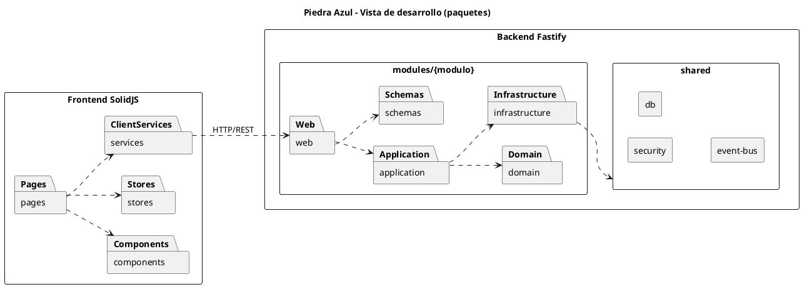

### 7.2. Diagrama UML de despliegue — Vista física

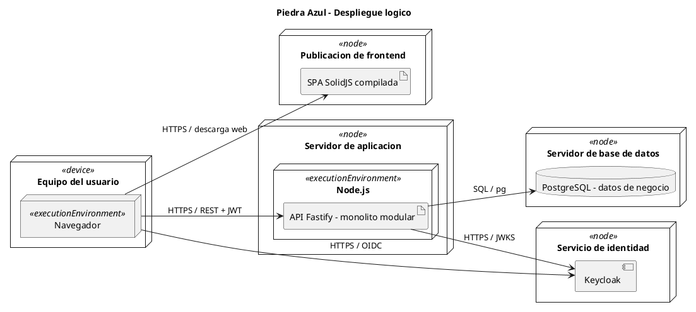

### 7.3. Diagrama UML de casos de uso — Vista +1

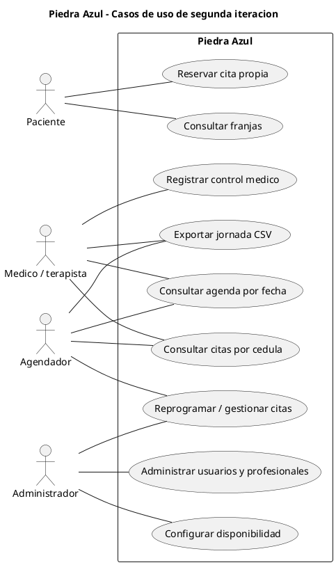

**Leyenda:** el rectángulo representa el límite del sistema, las figuras de actor representan roles externos y las elipses representan casos de uso. Los enlaces son asociaciones, no dependencias técnicas entre componentes. En despliegue, `«device»`, `«node»`, `«executionEnvironment»` y `«artifact»` identifican elementos de infraestructura y software, respectivamente. Los nodos no asignan un proveedor específico de alojamiento.

---

## 8. Conclusiones

La arquitectura de Piedra Azul se fundamenta en un **cliente web SolidJS**, una **API Fastify con organización monolítica modular**, una **base de datos PostgreSQL** y un **servicio externo Keycloak** para centralizar la identidad. Esta separación permite mantener los casos de uso del negocio independientes de la interfaz y distinguir autenticación de autorización.

Los diagramas C4 muestran el sistema desde el entorno hasta los componentes internos; las vistas 4+1 complementan esa descripción con el dominio, la estructura del código, el comportamiento temporal, el despliegue lógico y los escenarios que justifican las decisiones adoptadas. La revalidación de reservas, el control por rol y el tratamiento de la identidad del paciente son especialmente relevantes para la seguridad e integridad del agendamiento.

Este material corresponde al **apartado de arquitectura y diseño del segundo corte**. Sus diagramas y explicaciones pueden incorporarse al documento grupal de arquitectura, junto con las historias de usuario, prototipos, pruebas de usabilidad, escenarios de calidad de seguridad, patrones GoF y demás evidencias indicadas en la guía de la asignatura.
