# PIEDRA AZUL

**Documento de arquitectura de software — Segunda iteración**

Universidad del Cauca  
Facultad de Ingeniería Electrónica y Telecomunicaciones  
Programa de Ingeniería de Sistemas  
**Ingeniería de Software III — Segundo corte, 2026-2**  
**Proyecto:** Sistema web de reserva y gestión de citas médicas y terapéuticas  
**Equipo de desarrollo:** Piedra Azul  
**Repositorio:** https://github.com/gvalen03/piedra-azul

---

## 1. Introducción

Piedra Azul es una aplicación web para gestionar pacientes, profesionales de la salud, disponibilidad, reservas, agenda y controles de atención. En su segunda iteración se enfatiza la consulta de agendas, reserva autónoma de pacientes, configuración de horarios por parte de administración, exportación de la jornada a CSV y consulta de citas por documento de identificación.

Este documento reúne las historias de usuario de la segunda iteración, los criterios de aceptación, los prototipos, el instrumento de evaluación de usabilidad, la planificación del Sprint 2, los escenarios de seguridad, los diagramas C4 y UML 4+1 y los patrones de diseño del sistema. La solución se organiza como un monolito modular: SolidJS y Vite para la interfaz, Fastify sobre Node.js para los servicios y PostgreSQL para los datos. La arquitectura de identidad de esta iteración incorpora Keycloak como proveedor externo de autenticación mediante JWT.

## 2. Historias de usuario implementadas en la segunda iteración

Las siguientes historias corresponden a los cinco requisitos funcionales establecidos para el segundo corte. Sus criterios de aceptación describen comportamientos observables desde la interfaz y la API.


### HU-01 — Consultar agenda por profesional y fecha (RF-01)

**Historia:** Como **agendador de citas**, necesito consultar las citas médicas de un médico o terapista en una fecha determinada para visualizar el listado y la cantidad de citas de la jornada.

**Criterios de aceptación:**

- **CA-01.1.** Dado un agendador autenticado, cuando selecciona un médico y una fecha válida y consulta, entonces obtiene las citas correspondientes exclusivamente a ese profesional y día.
- **CA-01.2.** El sistema muestra la **cantidad** de citas devueltas, coherente con el conjunto listado; los registros permiten identificar horario, paciente y estado.
- **CA-01.3.** Si la consulta no tiene resultados, el sistema comunica que no hay citas, sin presentar registros de otra fecha o profesional.
- **CA-01.4.** Una solicitud con fecha incorrecta o profesional inexistente recibe un mensaje apropiado; las consultas protegidas requieren permisos válidos.

**Referencia técnica:** `frontend/src/pages/citas/CitasPage.jsx`; `backend/src/modules/citas/application/cita.service.js`; `backend/src/modules/citas/infrastructure/cita.repository.js`. La lista del médico se consulta también en `frontend/src/pages/medicos/MedicoPage.jsx`.

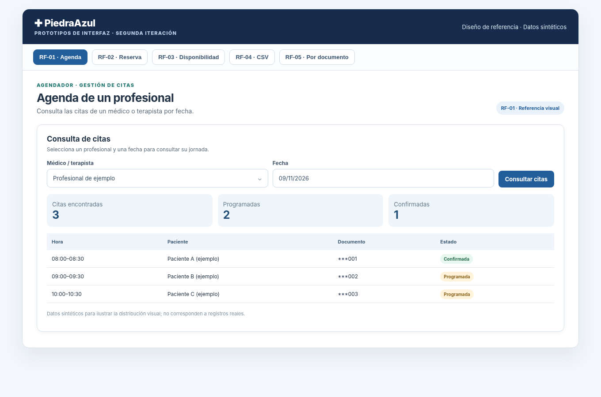

*Figura 1. Prototipo de interfaz para la historia HU-01.*

### HU-02 — Reservar una cita de manera autónoma (RF-02)

**Historia:** Como **paciente**, necesito reservar una cita desde la web para obtener atención sin depender de WhatsApp y poder escoger un horario disponible de forma sencilla.

**Criterios de aceptación:**

- **CA-02.1.** Dado un paciente con sesión válida y perfil activo, cuando accede a «Reservar cita», puede seleccionar profesional y fecha y consultar las franjas disponibles.
- **CA-02.2.** Cuando elige una franja libre y confirma la reserva, el sistema registra la cita vinculada **al paciente autenticado**, muestra una confirmación y la incluye en «Mis citas».
- **CA-02.3.** Una franja ocupada no puede reservarse nuevamente; si se produce un conflicto concurrente, se notifica y el horario no se duplica.
- **CA-02.4.** Cuando no existen franjas en la fecha solicitada, se informa al usuario sin permitir guardar una cita sin horario.
- **CA-02.5.** El paciente puede consultar, confirmar y cancelar sus propias citas de acuerdo con las reglas de fecha y estado, sin gestionar citas de otros pacientes.

**Referencia técnica:** `frontend/src/pages/pacientes/PacientePage.jsx`; `backend/src/modules/citas/web/cita.routes.js`; `backend/src/modules/disponibilidad/application/disponibilidad.service.js`; `backend/src/modules/citas/infrastructure/cita.repository.js`.

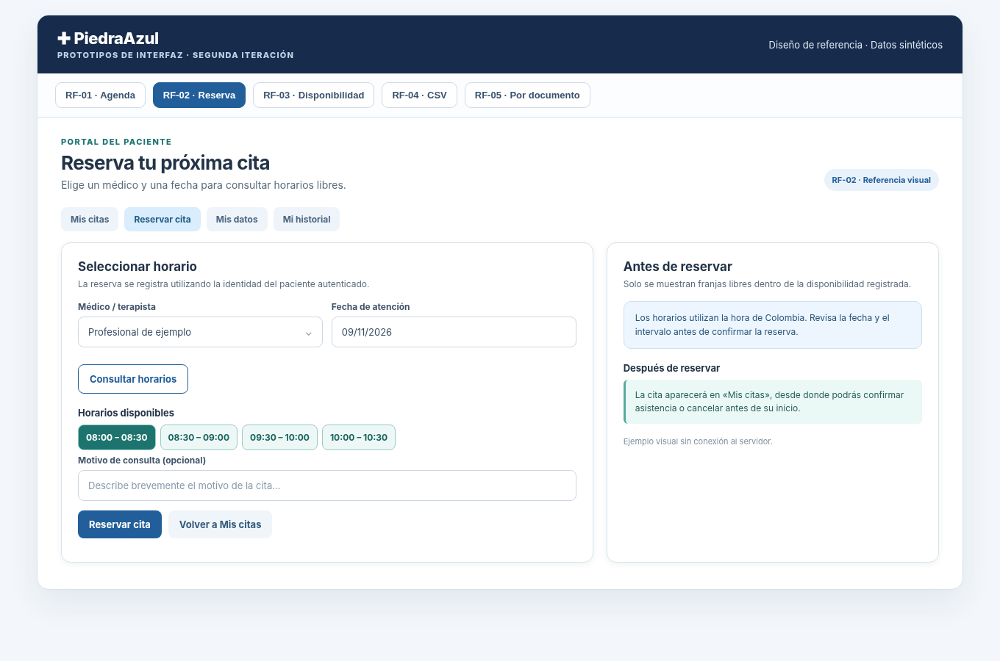

*Figura 2. Prototipo de interfaz para la historia HU-02.*

### HU-03 — Configurar la disponibilidad de atención (RF-03)

**Historia:** Como **administrador**, necesito configurar la disponibilidad de médicos y terapistas para que las reservas autónomas respeten sus días, franjas, duración de citas y ventana temporal habilitada.

**Criterios de aceptación:**

- **CA-03.1.** El administrador puede seleccionar un profesional activo y registrar día de la semana, hora de inicio y fin, intervalo en minutos y semanas habilitadas.
- **CA-03.2.** El sistema rechaza intervalos o semanas no positivos, horarios invertidos, bloques que no permiten una cita completa y horarios solapados para el mismo profesional.
- **CA-03.3.** Al modificar un bloque existente, el cambio se refleja en la consulta y en la vista previa de las franjas.
- **CA-03.4.** Al desactivar un bloque, deja de ofrecerse para **nuevas reservas**, sin eliminar citas previamente registradas.
- **CA-03.5.** Los usuarios sin rol autorizado no pueden modificar los horarios administrativos.

**Referencia técnica:** `frontend/src/pages/admin/AdminPage.jsx`; `frontend/src/components/medicos/DisponibilidadMedico.jsx`; `backend/src/modules/disponibilidad/web/disponibilidad.routes.js`; `backend/src/modules/disponibilidad/infrastructure/disponibilidad.repository.js`.

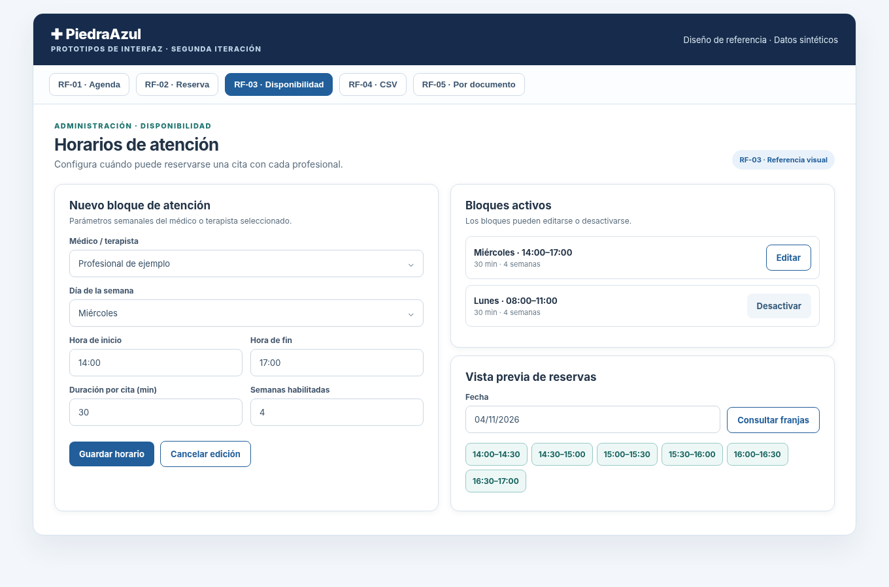

*Figura 3. Prototipo de interfaz para la historia HU-03.*

### HU-04 — Exportar las citas de una jornada (RF-04)

**Historia:** Como **médico, terapista o agendador**, necesito exportar las citas correspondientes a un profesional y una fecha en formato CSV para organizar la jornada y facilitar su consulta desde una hoja de cálculo.

**Criterios de aceptación:**

- **CA-04.1.** Dado un usuario autorizado, cuando selecciona fecha y profesional según sus permisos y ejecuta «Exportar CSV», recibe un archivo descargable correspondiente a esa selección.
- **CA-04.2.** El contenido incluye columnas identificables de fecha, hora, documento, paciente y estado; es legible en un programa de hojas de cálculo.
- **CA-04.3.** La exportación de la jornada excluye las citas canceladas y conserva las vigentes según la regla funcional implementada.
- **CA-04.4.** Si no existen citas exportables, se obtiene un CSV válido con encabezados; si la fecha no es válida o se exceden los permisos, la operación presenta un error comprensible.
- **CA-04.5.** Un médico únicamente puede exportar su propia agenda.

**Referencia técnica:** `frontend/src/pages/medicos/MedicoPage.jsx`, `frontend/src/pages/citas/CitasPage.jsx`; `frontend/src/services/descarga-csv.js`; `backend/src/modules/citas/application/cita.service.js` (flujo de exportación CSV).

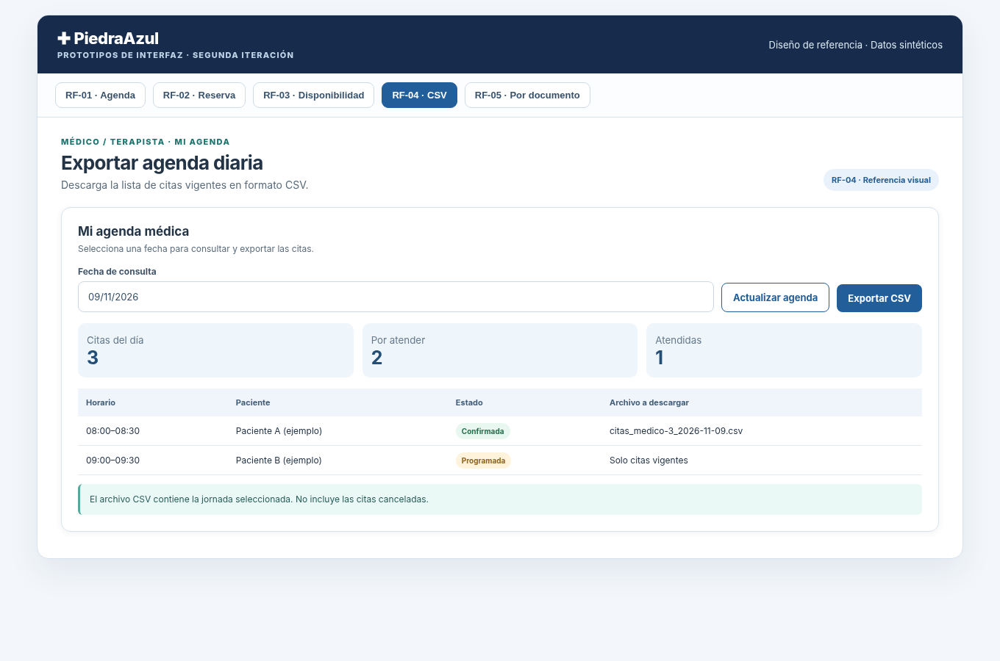

*Figura 4. Prototipo de interfaz para la historia HU-04.*

### HU-05 — Consultar citas de un paciente por cédula (RF-05)

**Historia:** Como **médico, terapista o agendador**, necesito buscar las citas de un paciente mediante su número de documento para conocer su historial de citas.

**Criterios de aceptación:**

- **CA-05.1.** El usuario autorizado introduce un documento y consulta las citas asociadas exclusivamente al paciente identificado.
- **CA-05.2.** Se presentan fecha, horario, profesional y estado para las citas encontradas, incluidas las anteriores y futuras de acuerdo con el registro.
- **CA-05.3.** Cuando no hay resultados, se informa claramente sin mostrar datos de otro paciente.
- **CA-05.4.** La interfaz no expone diagnósticos ni observaciones clínicas en el listado de citas.
- **CA-05.5.** La consulta requiere sesión válida y rol `AGENDADOR` o `MEDICO_TERAPISTA`; para el médico, el resultado se limita a las citas vinculadas a su propio perfil profesional.

**Referencia técnica:** `frontend/src/components/citas/ConsultaCitasPaciente.jsx`; `frontend/src/pages/citas/CitasPage.jsx`; `backend/src/modules/historial/web/historial.routes.js` y `backend/src/modules/historial/infrastructure/historial.repository.js`. La consulta utiliza `GET /api/historial/pacientes/{documento}/citas`.

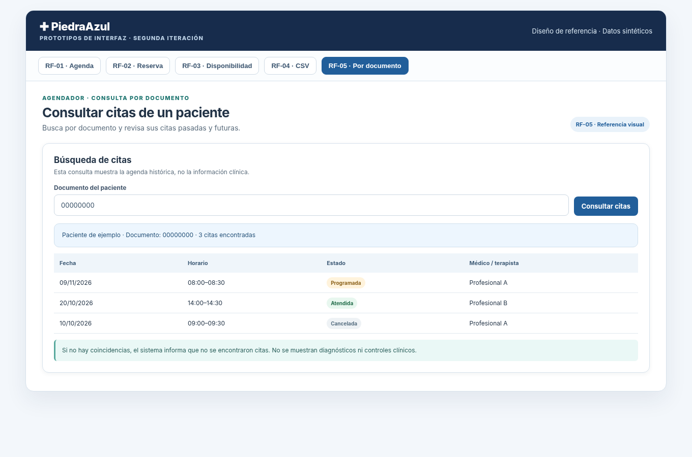

*Figura 5. Prototipo de interfaz para la historia HU-05.*

## 3. Prototipos de interfaz de usuario

Las cinco figuras incluidas junto a las historias representan las pantallas de consulta de agenda, reserva, disponibilidad, exportación CSV y búsqueda por documento. Se elaboraron a partir de los flujos de Piedra Azul con datos ficticios. El conjunto puede consultarse también en [Prototipos de interfaz](../ux/ARCH-03-prototipos.html).

| Prototipo | Pantalla / flujo | Historia |
|---|---|---|
| P01 | Agenda por médico y fecha | HU-01 |
| P02 | Reserva del paciente | HU-02 |
| P03 | Configuración de disponibilidad | HU-03 |
| P04 | Exportación CSV de una jornada | HU-04 |
| P05 | Consulta de citas por documento | HU-05 |

Las pantallas utilizan etiquetas para identificar médico, fecha y horario; separan las funciones según el rol; muestran mensajes de resultado y de ausencia de disponibilidad; y solicitan confirmación antes de cancelar una cita o desactivar un bloque de atención.

## 4. Test de evaluación de usabilidad

### 4.1. Objetivo y procedimiento

La evaluación busca observar si una persona puede consultar una agenda o reservar una cita sin recibir instrucciones sobre los controles de la pantalla. Para cada sesión se utiliza una cuenta de prueba, se entrega una tarea concreta y se registra el tiempo, el resultado y las dificultades encontradas. El moderador solo interviene cuando sea necesario y deja constancia de la ayuda prestada.

**Participantes y datos:** voluntarios adultos identificados con códigos P01, P02, etc. Se registrará experiencia general con plataformas de citas y rol de prueba, sin utilizar documentos de identidad ni datos médicos reales. Una misma persona puede efectuar varias tareas con cuentas ficticias.

**Consentimiento:** «Queremos conocer qué tan fácil resulta utilizar el sistema de citas. Se registrarán tiempos, dificultades y comentarios, sin guardar datos personales ni clínicos. La participación es voluntaria y puede detenerse en cualquier momento. ¿Acepta participar?»

### 4.2. Tareas y criterios

| Tarea | Consigna entregada | Éxito observable | Umbral orientativo* |
|---|---|---|---|
| T1 / Reserva | Reserva una cita la semana próxima en un horario disponible. | Reserva confirmada en «Mis citas». | 3 minutos |
| T2 / Agenda | Consulta las citas de un profesional en una fecha. | Encuentra la lista e identifica la cantidad. | 2 minutos |
| T3 / Disponibilidad | Configura miércoles 14–17, intervalos de 30 min y horizonte de 4 semanas. | Bloque guardado y franjas reflejadas. | 4 minutos |
| T4 / CSV | Descarga las citas de una jornada. | Archivo CSV descargado y reconocible. | 2 minutos |
| T5 / Documento | Consulta las citas de un paciente con el documento de prueba. | Lista de citas encontrada sin datos clínicos. | 2 minutos |

*Los umbrales son referencias propuestas para evaluar, no tiempos que se hayan medido.*

### 4.3. Instrumento de registro

| Participante | Tarea | Éxito sin ayuda | Tiempo (s) | Dificultad observada | Comentario o mejora |
|---|---|---|---|---|---|
| — | — | — | — | — | — |

El tiempo se mide desde la entrega de la consigna hasta la finalización. La tasa de éxito se calcula como (tareas completadas sin ayuda / tareas realizadas) × 100. Las dificultades se clasifican como altas cuando impiden terminar, medias cuando retrasan la tarea y bajas cuando no afectan el resultado.

Los resultados se incorporan una vez realizada la sesión. Las verificaciones funcionales del sistema y las pruebas automatizadas se documentan por separado, ya que evalúan aspectos distintos del uso por parte de una persona.

## 5. Planificación del Sprint 2

El equipo organiza el Sprint 2 en GitHub Projects, donde registra requisitos, responsables y estados de trabajo. Esta planificación permite relacionar el desarrollo de las funcionalidades con las tareas de pruebas, seguridad y arquitectura.

**Figura 6. Planificación del Sprint 2 en el tablero del equipo.** En esta sección se incorpora la captura del tablero utilizado por el grupo, con sus tareas y columnas de seguimiento, antes de generar el documento de entrega.

## 6. Escenarios de calidad: seguridad

Los escenarios de seguridad establecen condiciones observables para los controles de autenticación y autorización. Cada uno identifica el estímulo, la respuesta del sistema y la forma de comprobar el resultado.

### ESC-SEG-01. Token ausente, inválido o vencido

| Elemento | Descripción |
|---|---|
| Fuente | Persona o cliente HTTP sin credenciales válidas |
| Estímulo | Solicita una operación protegida usando un JWT ausente, manipulado o expirado |
| Artefacto | Verificación JWT de la API Fastify, integración con Keycloak y ruta protegida |
| Entorno | Sistema en operación normal, consulta a `/api/citas/mis-citas` |
| Respuesta | Rechaza la operación antes de entregar citas o ejecutar cambios |
| Medición | Código HTTP **401**; ninguna reserva creada ni registro sensible expuesto |
| Resultado esperado | El usuario debe autenticarse nuevamente; no accede a datos propios ni ajenos sin token válido |

### ESC-SEG-02. Acceso de un rol no autorizado

| Elemento | Descripción |
|---|---|
| Fuente | Usuario autenticado con rol PACIENTE |
| Estímulo | Intenta crear o cambiar la disponibilidad administrativa de un profesional |
| Artefacto | Control de roles/permisos del backend y módulo disponibilidad |
| Entorno | API operativa con una cuenta de prueba PACIENTE y un profesional sintético |
| Respuesta | Rechaza la operación y conserva los bloques de disponibilidad originales |
| Medición | Código HTTP **403** y ausencia de modificaciones en PostgreSQL |
| Resultado esperado | Solo los roles autorizados administran la configuración de disponibilidad |

La configuración arquitectónica de identidad considera Keycloak para la emisión de tokens y una verificación consistente de firma, emisor, audiencia, expiración y roles en la API. Los permisos sobre recursos de negocio se deben validar también en el servidor, independientemente de los controles de la interfaz.

## 7. Arquitectura y diseño de software: C4 y UML 4+1

### 7.1. Modelo C4


Los niveles C4 se leen de lo general a lo particular. El contexto delimita el sistema; los contenedores identifican unidades ejecutables o de datos; y los componentes muestran responsabilidades internas del backend. En las figuras, **Keycloak es un sistema externo de identidad**, no un módulo Fastify ni una base de datos clínica.

#### 7.1.1. C4 nivel 1 — Diagrama de contexto

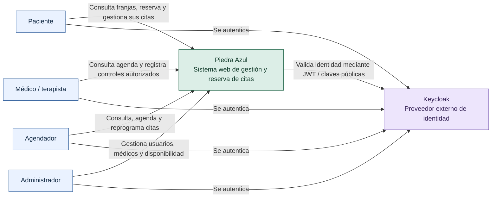

**Figura 7. Contexto de Piedra Azul.** El paciente reserva y consulta sus citas; el médico consulta su agenda y registra atención; el agendador gestiona citas; y el administrador configura usuarios y disponibilidad. El sistema se relaciona con Keycloak para el servicio de identidad. La aplicación sigue siendo responsable de proteger sus operaciones y datos clínicos.

| Actor | Necesidad principal | Control relevante |
|---|---|---|
| Paciente | Consultar franjas, reservar, confirmar/cancelar y revisar sus citas | Solo opera sobre su perfil y citas asociadas |
| Médico o terapista | Consultar agenda, registrar atención y consultar información autorizada | Acceso restringido por rol y vínculo con el profesional |
| Agendador | Consultar agendas, reservar, reprogramar y consultar pacientes | Roles y validación de las operaciones de agenda |
| Administrador | Administrar cuentas, profesionales y configuración de disponibilidad | Operaciones administrativas protegidas |

#### 7.1.2. C4 nivel 2 — Diagrama de contenedores

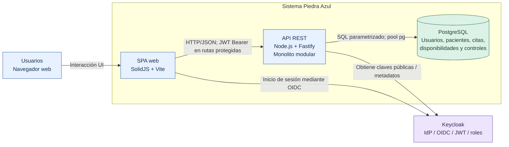

**Figura 8. Contenedores de Piedra Azul.** La SPA presenta la interfaz; la API ejecuta la lógica y expone endpoints REST; PostgreSQL almacena los datos del negocio; Keycloak actúa como proveedor externo de identidad. Los módulos del backend forman **un único monolito modular**, por lo que no deben dibujarse como servicios desplegados de forma independiente.

**Comunicación principal:** el navegador consume recursos de la API a través de HTTP/JSON y envía un token de acceso para operaciones protegidas; el backend utiliza consultas SQL parametrizadas a PostgreSQL. La autenticación externa establece una frontera de confianza adicional entre el usuario, el proveedor de identidad y la API.

#### 7.1.3. C4 nivel 3 — Componentes principales del backend

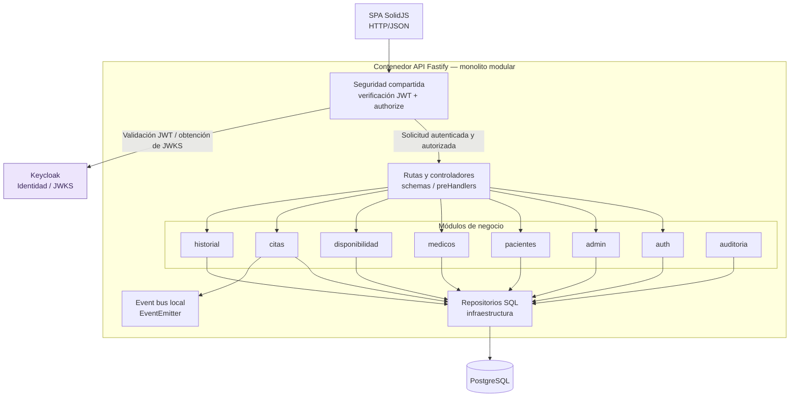

**Figura 9. Componentes del contenedor Fastify.** Las rutas y controladores reciben peticiones, los servicios coordinan reglas de aplicación, las entidades representan conceptos del dominio y los repositorios abstraen la persistencia. La seguridad y auditoría son preocupaciones transversales. Los módulos identificados son: `admin`, `auth`, `medicos`, `pacientes`, `disponibilidad`, `citas`, `historial` y `auditoria`.

La composición de los servicios, sus controladores y sus repositorios se realiza en `backend/src/app.js`. La seguridad compartida establece los permisos aplicables a cada ruta; el proveedor de identidad no reemplaza estas reglas de autorización del negocio.

#### 7.1.4. C4 nivel 3 — Componentes del agendamiento

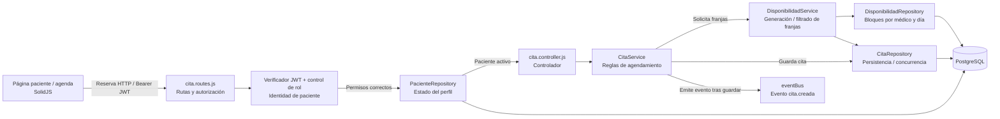

**Figura 10. Detalle de componentes para reservar citas.** La ruta protegida valida la identidad, obtiene el identificador del paciente de la sesión y verifica su estado. `CitaService` consulta franjas mediante `DisponibilidadService`, comprueba el horario y coordina la reserva a través de `CitaRepository`. La persistencia vuelve a comprobar la ocupación dentro de una operación transaccional. Esto es importante porque una franja pudo liberarse o ocuparse entre la consulta inicial y el envío de la reserva.

El módulo Citas también articula consulta de agenda, confirmación, cancelación y reprogramación. Para la segunda iteración contempla la exportación de listados de jornada a CSV. El módulo de Pacientes aporta datos de identificación y perfil necesarios para los accesos autorizados.

---

### 7.2. Arquitectura mediante el modelo UML 4+1

El modelo 4+1 organiza el sistema desde cuatro perspectivas complementarias y una vista de escenarios que las relaciona.

| Vista | Pregunta que responde | Representación |
|---|---|---|
| Lógica | ¿Qué entidades y conceptos conforman el dominio? | Modelo de clases |
| Desarrollo | ¿Cómo se organiza el código y cuáles son las dependencias? | Paquetes y módulos |
| Procesos | ¿Cómo colaboran los elementos durante una operación? | Diagrama de secuencia |
| Física | ¿Cómo se distribuyen los procesos y servicios de la solución? | Despliegue lógico |
| +1 Escenarios | ¿Qué casos de uso justifican la arquitectura? | Casos de uso y secuencias |

#### 7.2.1. Vista lógica — Modelo de clases

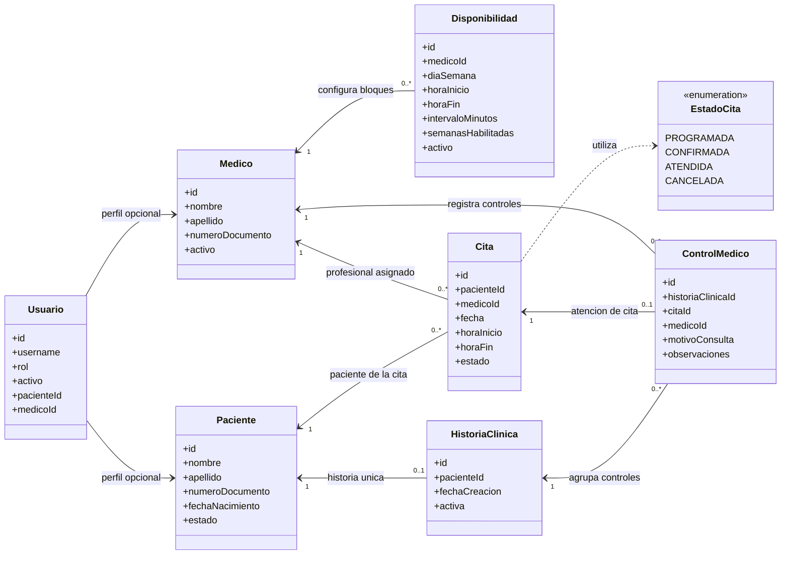

**Figura 11. Entidades principales del dominio.** `Usuario` representa la cuenta y su rol; `Paciente` y `Medico` los perfiles del negocio; `Disponibilidad` configura días, horas y duración de franjas; `Cita` relaciona paciente, profesional y horario; e `HistoriaClinica` y `ControlMedico` modelan la información de la atención. Los estados de cita son `PROGRAMADA`, `CONFIRMADA`, `ATENDIDA` y `CANCELADA`.

Las asociaciones combinan el modelo de dominio con reglas aplicadas por los repositorios. Una cita pertenece a un paciente y a un profesional; un profesional puede tener varias disponibilidades y citas. Cada paciente mantiene como máximo una historia clínica en el esquema utilizado por `HistorialRepository`, que emplea `ON CONFLICT (paciente_id)`. Cada cita admite como máximo un control médico, comprobado al registrar una atención. Los vínculos de `Usuario` con perfiles de paciente o profesional son opcionales y se muestran sin fijar multiplicidades que no se hayan contrastado con todas las restricciones de la base de datos. Los atributos se sintetizan para que el diagrama sea legible.

**Invariantes principales del negocio:**

1. Una franja debe tener horas válidas y ordenadas; el intervalo debe ser positivo y caber en el bloque.
2. Las reservas no pueden utilizar una franja fuera del período habilitado ni una franja ocupada.
3. La consulta y modificación de citas propias dependen de la identidad autenticada y de su perfil interno.
4. El registro de atención médica exige validaciones de vínculo y campos mínimos del control.

#### 7.2.2. Vista de desarrollo — Organización de módulos

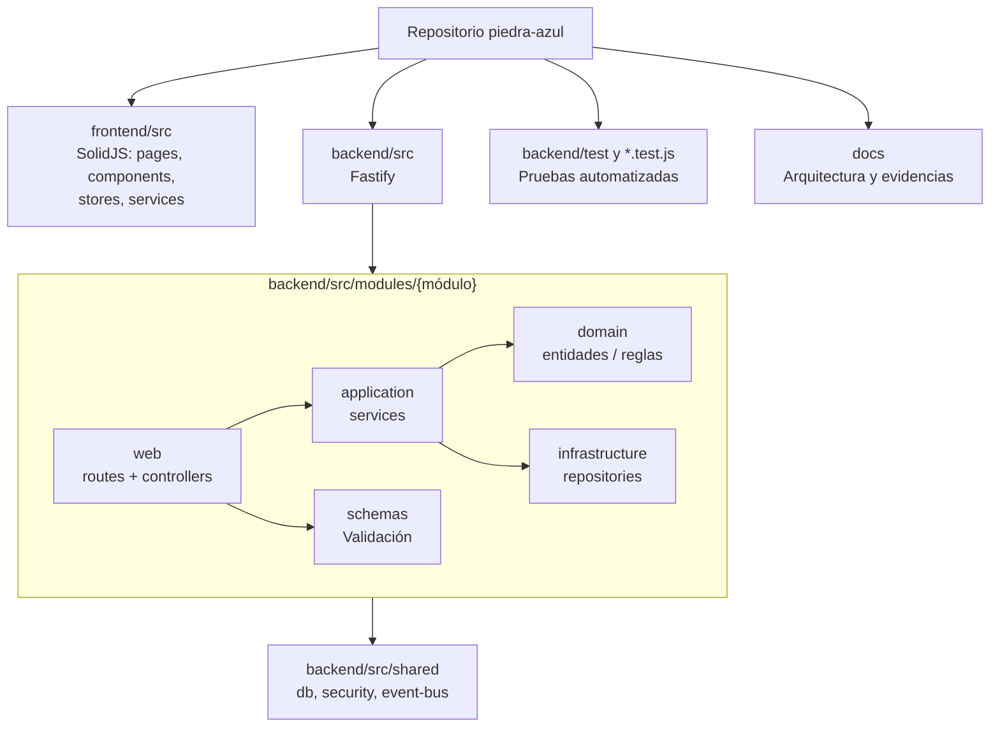

**Figura 12. Organización de desarrollo.** Esta representación sintetiza la vista de paquetes del código (la versión UML de paquetes se encuentra en el documento ARCH-02). El repositorio contiene una aplicación frontend y una aplicación backend. En el backend, el patrón modular separa `web` (rutas/controladores), `application` (casos de uso/servicios), `domain` (entidades y conceptos), `infrastructure` (repositorios) y `schemas` (validación de solicitudes). Las dependencias concretas se componen al iniciar Fastify.

Esta separación favorece pruebas con dependencias sustituidas, mantenimiento localizado y una interfaz desacoplada de la persistencia. **No implica** que todas las operaciones adopten idéntica estructura ni que existan servicios de red por módulo.

#### 7.2.3. Vista de procesos — Reserva de una cita

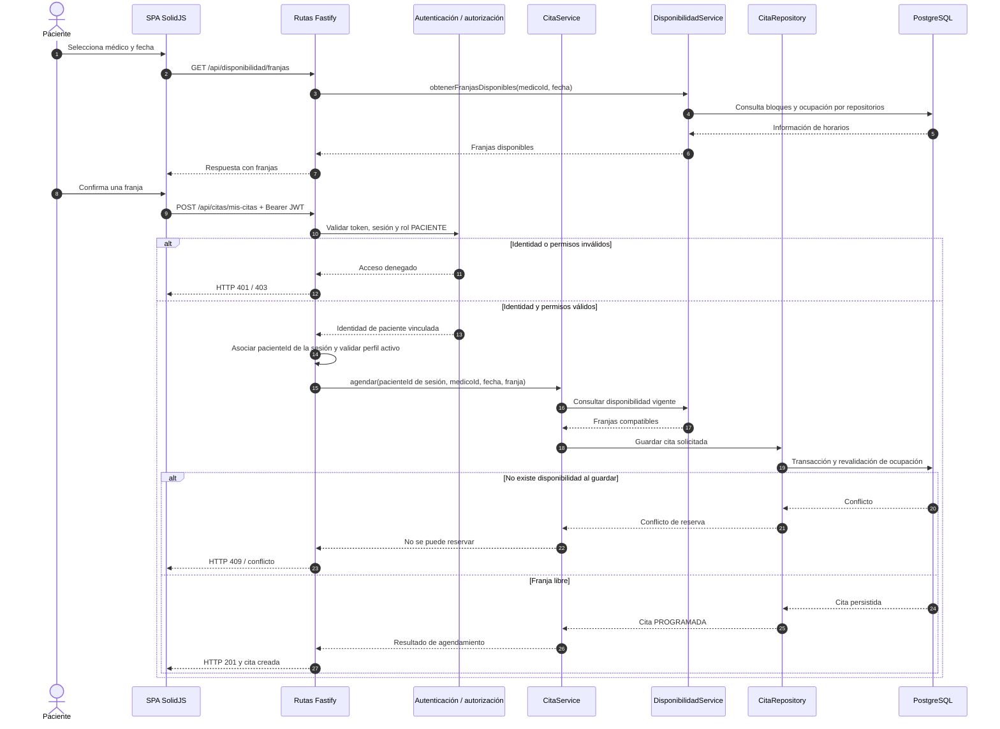

**Figura 13. Secuencia de reserva autónoma.** El paciente consulta horarios y envía la selección. Antes de ejecutar el caso de uso se valida la identidad y autorización; la API obtiene la identidad del paciente a partir de la sesión y el backend revalida la disponibilidad al guardar. El tratamiento de conflictos evita asumir que una franja consultada anteriormente continúa libre.

**Responsabilidades temporales:**

- La SPA recopila fecha, profesional y franja, pero no decide permisos ni persistencia.
- Fastify aplica las reglas de acceso de cada ruta.
- Los servicios coordinan la disponibilidad y las reglas de reserva.
- Los repositorios ejecutan el acceso SQL y las operaciones transaccionales.

#### 7.2.4. Vista física — Despliegue lógico

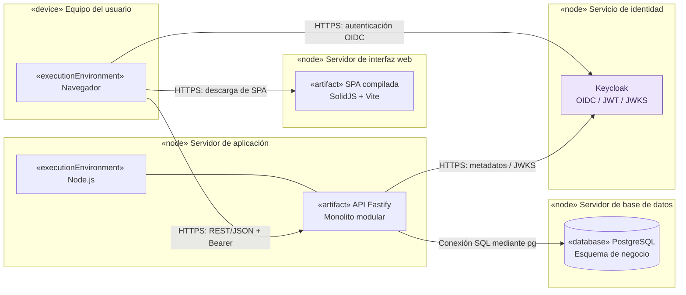

**Figura 14. Vista de despliegue lógico (representación UML mediante estereotipos).** El modelo distingue dispositivos, nodos, entornos de ejecución y artefactos: equipo del usuario, publicación de la SPA, proceso Node/Fastify, PostgreSQL y Keycloak. El documento ARCH-02 conserva la fuente PlantUML para exportar esta vista con notación UML de despliegue. La separación representa responsabilidades y canales de comunicación; **no prescribe** un proveedor de alojamiento concreto ni confunde un flujo de trabajo de publicación con un servicio ya operativo.

Para proteger la solución, las comunicaciones externas deben emplear HTTPS; la conexión de aplicación con PostgreSQL utiliza credenciales configuradas fuera del código; y los secretos, la configuración del realm y las direcciones de servicios deben gestionarse mediante el entorno de ejecución.

#### 7.2.5. Vista +1 — Casos de uso y escenarios

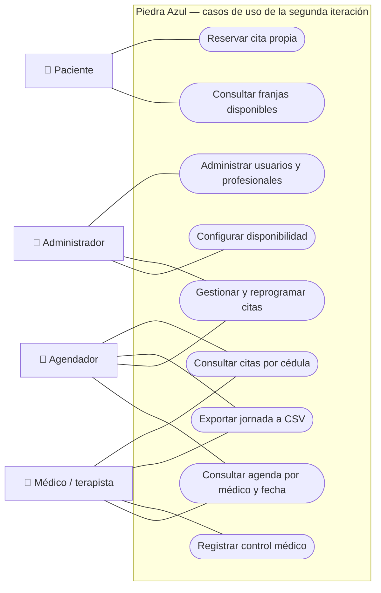

**Figura 15. Casos de uso de la segunda iteración.** El esquema Mermaid presenta actores, asociaciones y límite del sistema con una disposición equivalente a casos de uso; su versión PlantUML está disponible en el documento ARCH-02 para exportar un diagrama UML de casos de uso. El diagrama combina los recorridos clave del sistema con los cinco requisitos funcionales del corte: consulta de agendas, reserva del paciente, configuración administrativa, exportación CSV y consulta de citas por documento. Los casos de atención clínica y administración proporcionan contexto al dominio.

#### Escenario A — Configurar disponibilidad de un profesional

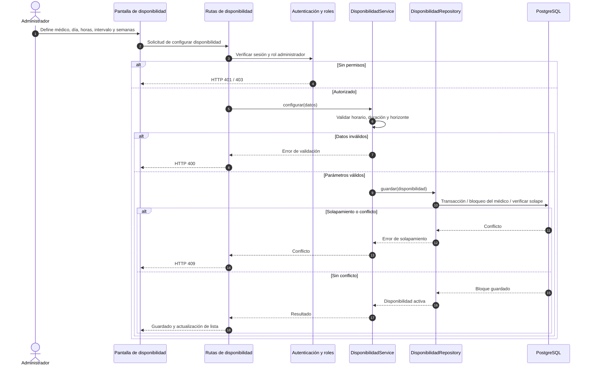

**Figura 16. Secuencia de configuración de disponibilidad.** El administrador introduce el día, el horario, el intervalo y el horizonte de semanas. La API valida su rol, el servicio comprueba los valores y el repositorio evita solapamientos mediante validaciones transaccionales. Una configuración válida permite generar las franjas que después visualiza el paciente.

#### Escenarios arquitectónicos de referencia

| Escenario | Componentes que participan | Resultado funcional esperado |
|---|---|---|
| E1. Reservar cita propia | SPA, autenticación, Citas, Disponibilidad, PostgreSQL | Registrar una cita válida para el paciente autenticado, sin doble ocupación |
| E2. Configurar disponibilidad | Administración, Disponibilidad, PostgreSQL | Crear o actualizar bloques válidos y rechazar solapamientos |
| E3. Consultar agenda médica | SPA, Citas, repositorio | Mostrar citas por profesional y fecha, con listado y cantidad |
| E4. Exportar jornada CSV | Agenda, Citas y serialización CSV | Obtener un archivo de texto compatible con hojas de cálculo |
| E5. Consultar citas por documento | Pacientes, Citas y base de datos | Localizar las citas del paciente según los permisos del actor |
| E6. Registrar control médico | Historial, validación de identidad y PostgreSQL | Asociar un control autorizado a una cita y profesional |
| E7. Autenticación y autorización | SPA, Keycloak, API Fastify y perfil interno | Validar identidad y roles; denegar acceso inválido o insuficiente |

Estos escenarios conectan las vistas arquitectónicas con las funcionalidades de la iteración. **Las pruebas de aceptación y de usabilidad pertenecen a su documentación específica** y no se deducen únicamente de los diagramas.

---

### 7.3. Diseño de autenticación y autorización con Keycloak

Keycloak constituye la **frontera externa de identidad** de Piedra Azul. Su responsabilidad es autenticar usuarios y emitir tokens de acceso; la API de negocio verifica las credenciales de acceso representadas por el JWT y aplica permisos propios para citas, pacientes, profesionales y controles clínicos. Esta organización evita colocar reglas de seguridad del negocio en los componentes visuales del navegador.

#### 7.3.1. Secuencia arquitectónica de autenticación y acceso

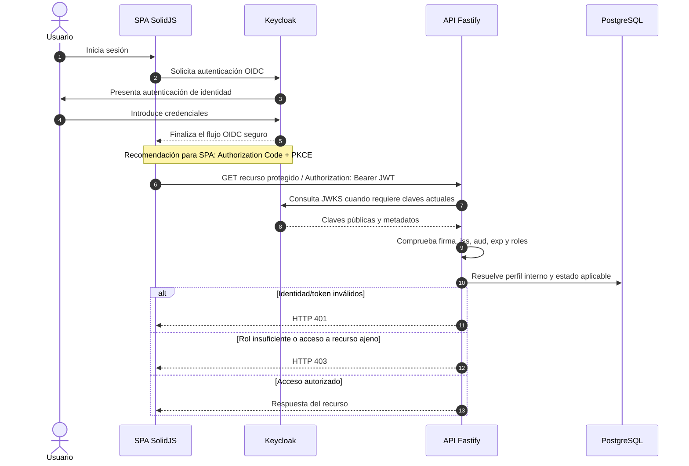

**Figura 17. Interacción entre la SPA, Keycloak y Fastify.** El esquema describe el intercambio de identidad de alto nivel. Para un cliente SPA, el flujo OIDC recomendado es Authorization Code con PKCE, sin exponer credenciales a Fastify. El token de acceso acompaña las solicitudes protegidas. La verificación de firma y los claims establece la identidad; la autorización comprueba además si el rol y el recurso solicitado son compatibles. La secuencia describe las responsabilidades del proceso de autenticación con Keycloak y los controles exigidos a las solicitudes protegidas.

#### 7.3.2. Responsabilidades y controles del diseño

| Elemento | Responsabilidad |
|---|---|
| Keycloak | Autenticar a los usuarios, emitir access tokens JWT y gestionar la información de roles según la configuración del realm |
| Cliente web | Iniciar el proceso de autenticación y enviar el token de acceso a la API por un canal protegido |
| Verificador JWT de la API | Validar firma y algoritmo, emisor (`iss`), destinatario o cliente (`aud` según configuración), expiración (`exp`) y vigencia (`nbf` cuando exista) |
| Mapeo de identidad | Interpretar los claims y asociar la identidad externa al usuario o perfil interno aplicable |
| Control de autorización | Aplicar roles `ADMINISTRADOR`, `AGENDADOR`, `MEDICO_TERAPISTA` y `PACIENTE`, además de permisos por propiedad del recurso |
| Persistencia | Conservar datos de negocio, perfiles y estados; no sustituir al proveedor externo de identidad |
| Respuestas de seguridad | Responder 401 ante identidad/token no válido y 403 cuando la identidad sea válida pero carezca del permiso necesario |

La API conserva la responsabilidad de comprobar los permisos sobre cada operación y de asociar el token con el perfil interno adecuado. La gestión centralizada de la identidad no sustituye estas verificaciones.

---

### 7.4. Decisiones arquitectónicas y compromisos

| ID | Decisión | Motivo técnico | Referencia del proyecto |
|---|---|---|---|
| DA-01 | Arquitectura **monolito modular** en Fastify | Compartir proceso y despliegue sin renunciar a límites funcionales | `backend/src/app.js` |
| DA-02 | Interfaz SPA con SolidJS y Vite | Separar navegación e interacción de los casos de uso del servidor | `frontend/src/App.jsx`, `frontend/package.json` |
| DA-03 | API REST y validación del servidor | Centralizar contratos, permisos y reglas, evitando confiar en la UI | `backend/src/modules/*/web/` |
| DA-04 | PostgreSQL como persistencia de negocio | Mantener consistencia y consultas de usuarios, horarios, citas y controles | `backend/src/shared/db/database.js` |
| DA-05 | Revalidar reservas en transacción | Reducir condiciones de carrera y horarios duplicados | `backend/src/modules/citas/infrastructure/cita.repository.js` |
| DA-06 | Seguridad centralizada con roles y recursos | Aplicar permisos también en backend, no solo al ocultar páginas | `backend/src/shared/security/authorize.js` y rutas |
| DA-07 | Keycloak como identidad externa | Cumplir el requisito de proveedor externo JWT y separar identidad de dominio | Requisito no funcional de la guía y contrato AUTH-01 |
| DA-08 | Eventos de dominio dentro del proceso | Informar acciones de citas sin convertir cada módulo en microservicio | `backend/src/shared/event-bus.js`, `CitaService` |
| DA-09 | Pruebas automatizadas con repositorios simulados | Verificar servicios y rutas sin depender siempre de una BD de prueba | Archivos `*.test.js` del backend |

#### 7.4.1. Riesgos arquitectónicos y medidas de control

| Riesgo | Impacto posible | Medida de diseño |
|---|---|---|
| Dependencia del proveedor de identidad | Interrupción de autenticación por indisponibilidad o configuración errónea | Integración desacoplada, validación robusta de tokens y configuración segura |
| Acceso indebido por roles o identidad | Consulta o modificación de recursos de otros usuarios | Autorización en cada ruta, asociación con perfil y comprobación de propiedad |
| Concurrencia al reservar | Dos solicitudes intentan ocupar una misma franja | Revalidación bajo transacción y bloqueos apropiados |
| Exposición de datos de salud | Acceso a controles o datos personales sin permiso | Control de acceso en el backend, datos mínimos y manejo responsable de evidencias |
| Acoplamiento entre módulos | Dificultad para evolucionar funciones sin regresiones | Separación web/aplicación/dominio/infraestructura y pruebas automatizadas |
| Configuración insegura | Divulgación de secretos o tokens, errores de conexión | Variables de entorno, HTTPS, manejo de tokens y configuración fuera del repositorio |

---


## 8. Patrones de diseño y su aplicación

### 8.1. Builder — construcción de pacientes

El módulo de pacientes incluye `PacienteBuilder`, una clase que permite crear objetos `Paciente` mediante una secuencia de métodos. El constructor recibe los datos básicos y los métodos `fechaNacimiento()`, `email()`, `direccion()`, `eps()` y `estado()` agregan información opcional antes de llamar a `build()`. La aplicación de este patrón de creación facilita la construcción de objetos con varios atributos sin exigir un constructor extenso en cada caso.

**Ubicación:** `backend/src/modules/pacientes/domain/paciente.builder.js`.

```js
const paciente = new PacienteBuilder(
  "Ana", "Pérez", "1000000000", "3000000000", "FEMENINO"
).email("ana@ejemplo.test")
 .direccion("Dirección de prueba")
 .build();
```

Este ejemplo utiliza datos ficticios y muestra la estructura de uso del Builder. El servicio `PacienteService` también dispone de `PacienteFactory` para crear entidades a partir de los datos recibidos.

### 8.2. Otras soluciones de diseño presentes en el código

| Solución | Implementación | Aplicación en el proyecto |
|---|---|---|
| Fábrica simple | `paciente.factory.js` y `usuario.factory.js` | Centraliza la creación de entidades y las reglas iniciales de estado o rol. Es una fábrica simple y no equivale por sí sola a Factory Method de GoF. |
| Eventos internos | `shared/event-bus.js` y `cita.service.js` | `EventEmitter` permite emitir sucesos como `cita.creada` o `cita.confirmada`. La emisión de eventos no demuestra por sí sola una implementación completa del patrón Observer; para ello se necesitan suscriptores identificables. |
| Repositorios | Módulos `infrastructure` | Aíslan las consultas y transacciones de PostgreSQL respecto a los servicios de aplicación. Es un patrón arquitectónico, no un patrón GoF. |
| Inyección de dependencias | `backend/src/app.js` | Los servicios reciben repositorios y colaboradores al crearse, lo que facilita sustituirlos durante las pruebas. |

Estas soluciones responden a necesidades distintas. En particular, no se confunden las prácticas de organización del backend con los patrones GoF.

## 9. Enlaces de entrega y referencias

**Repositorio Git:** https://github.com/gvalen03/piedra-azul  
**Video de sustentación en YouTube:** vínculo por incorporar después de la publicación.

**Material técnico del grupo:**

- `docs/arquitectura/ARCH-02-C4-UML-4mas1-Piedra-Azul.md`: fuente editable de los diagramas C4, 4+1 y PlantUML.
- `docs/ux/ARCH-03-historias-prototipos-usabilidad.md`: historias, prototipos y formato ampliado del test.
- `docs/ux/prototipos/`: imágenes de cinco pantallas de referencia.
- Código del repositorio: `frontend/src/`, `backend/src/` y sus pruebas.
- Guía académica: *EntregablesSegundoCorte2026.2-IngSoft3(1).pdf*, páginas 1–4.

## 10. Conclusiones

Piedra Azul conserva una arquitectura monolítica modular en la que la presentación, la lógica de negocio, la persistencia y la identidad tienen responsabilidades diferenciadas. La consulta de agendas, la reserva autónoma, la configuración de disponibilidad, la exportación CSV y la consulta por documento se relacionan mediante servicios y repositorios compartidos. Los modelos C4 y UML 4+1 permiten comprender esa organización y los flujos principales; las historias y los prototipos vinculan las decisiones técnicas con las necesidades de quienes utilizarán el sistema.
