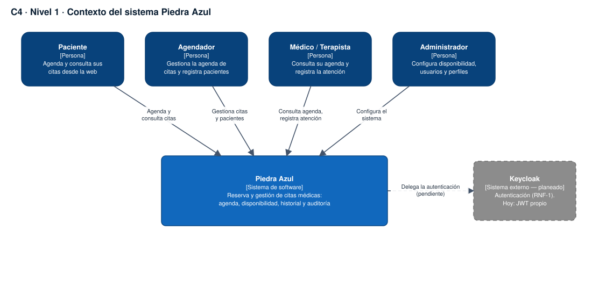
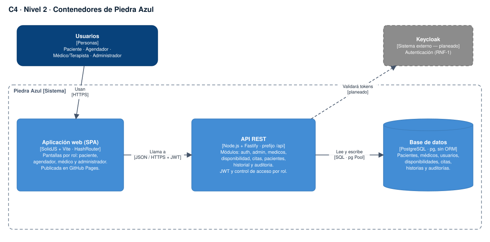
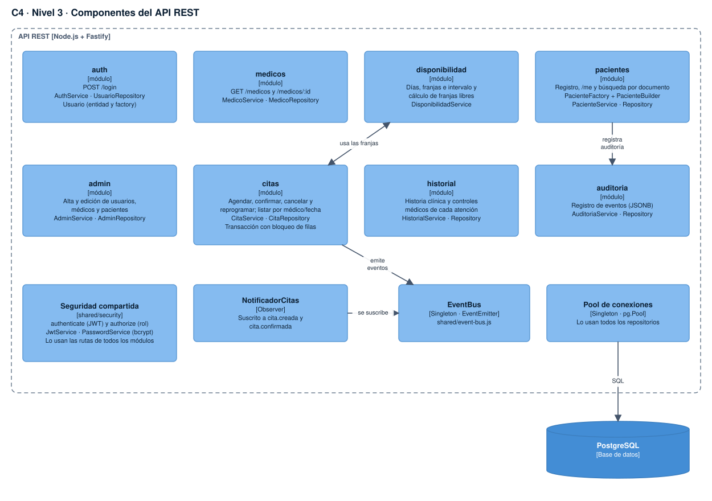

# Modelo C4

## Nivel 1 · Contexto

Cuatro tipos de usuario (paciente, agendador, médico/terapista, administrador) usan Piedra Azul para gestionar agenda, citas, pacientes e historial clínico. Keycloak aparece como sistema externo **planeado** (RNF-1); hoy la autenticación la resuelve la propia API con JWT.

## Nivel 2 · Contenedores

| Contenedor | Tecnología | Responsabilidad |
|---|---|---|
| Aplicación web (SPA) | SolidJS + Vite, HashRouter | Pantallas por rol. Publicada en GitHub Pages; llama a la API con el JWT. |
| API REST | Node.js + Fastify, prefijo `/api` | Reglas de negocio, validación (JSON Schema), autenticación y autorización por rol. |
| Base de datos | PostgreSQL, `pg` sin ORM | Pacientes, médicos, usuarios, disponibilidades, citas, historias y auditorías. |

La SPA vive en otro origen (`https://gvalen03.github.io`), por lo que la API habilita CORS para él y expone las cabeceras necesarias (p. ej. `Content-Disposition` para la exportación CSV).

## Nivel 3 · Componentes de la API

Cada módulo repite la misma cadena: **ruta → controlador → servicio → repositorio**, con validación por esquema en la entrada y los `preHandler` `authenticate` + `authorize(roles)` en el acceso. `CitaService` es el componente central: coordina `DisponibilidadService`, `CitaRepository` y el `eventBus`, al que se suscribe `NotificadorCitas`.
