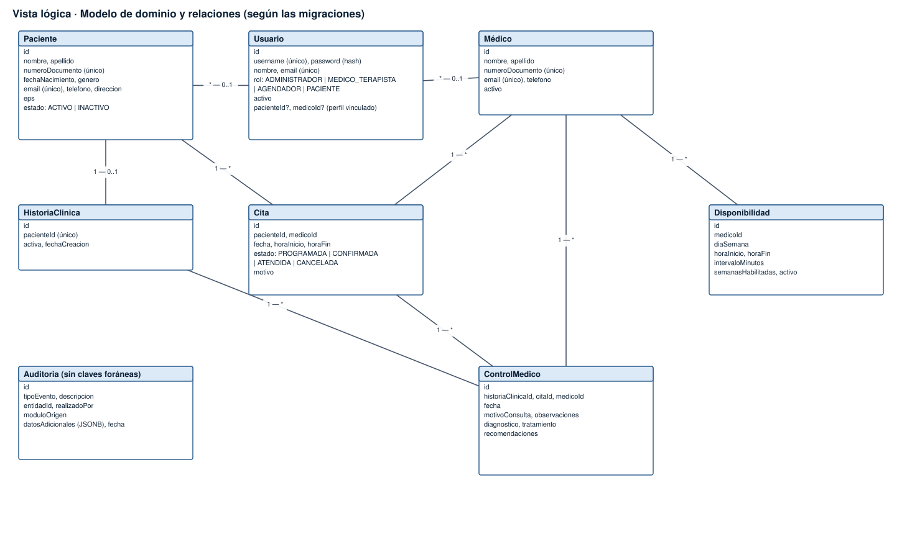
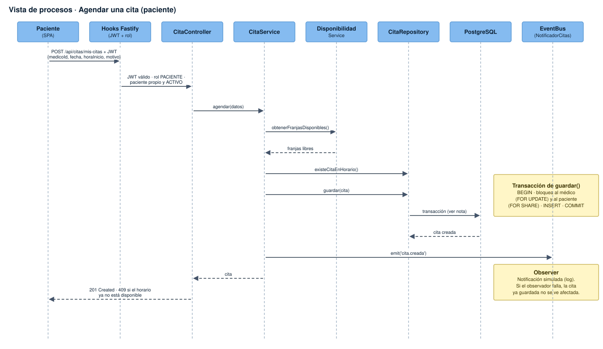
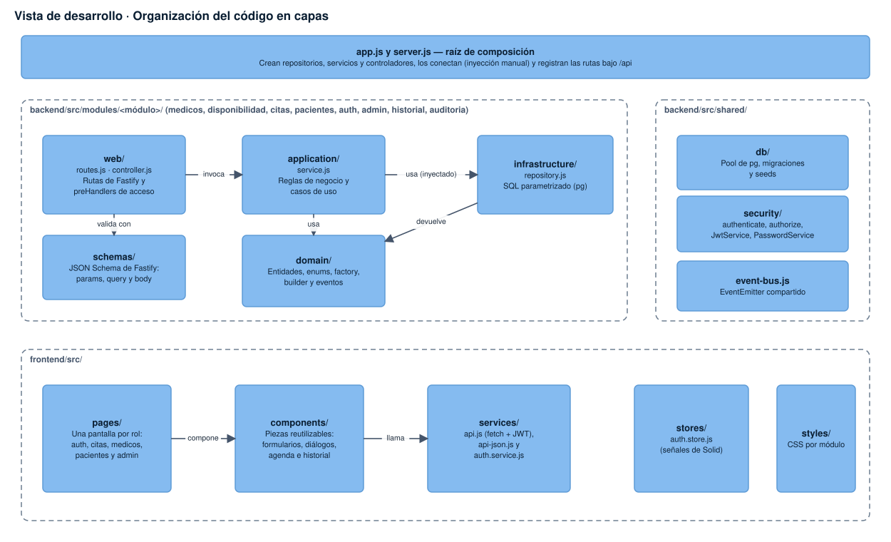
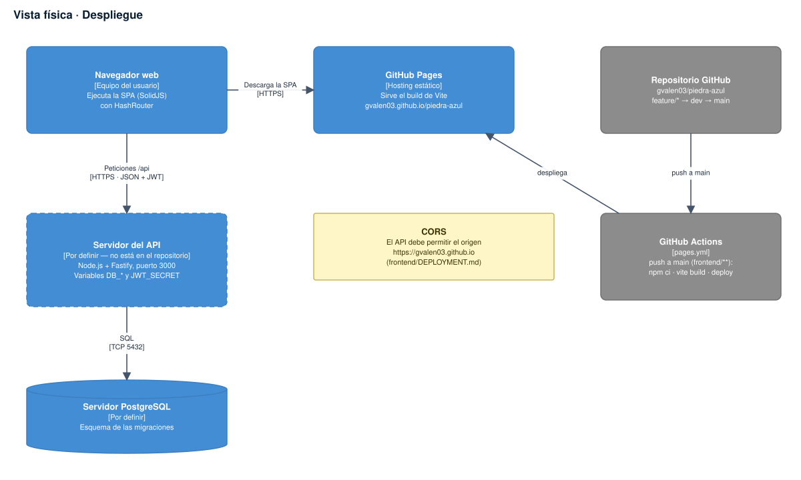
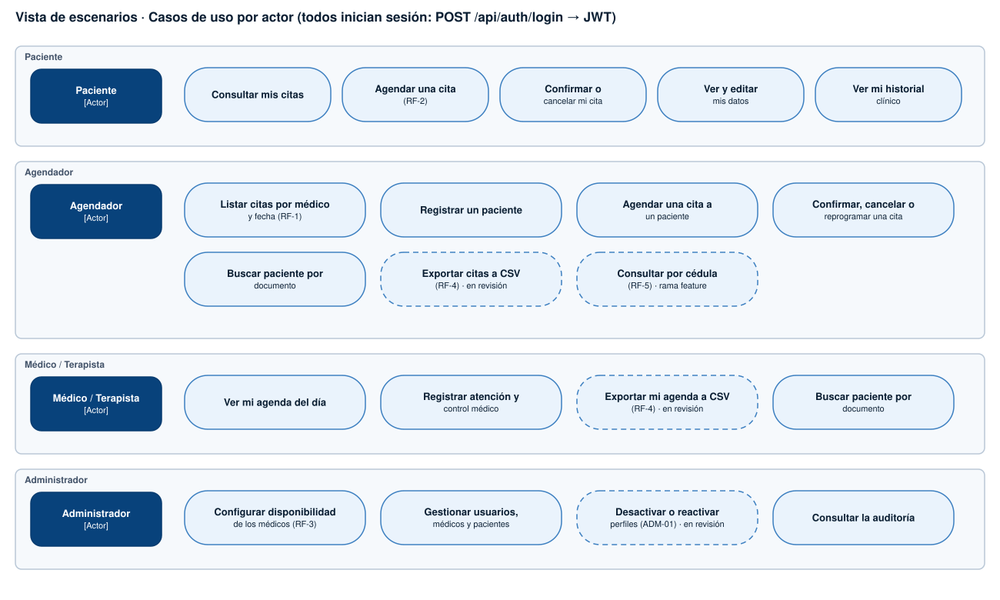

# Vistas 4+1

## Vista lógica

Entidades del dominio y su cardinalidad según las migraciones:

- `Usuario` se vincula a lo sumo a un `Paciente` o un `Medico` (FK opcionales). La base **no** impone unicidad sobre `paciente_id`/`medico_id`, por eso la multiplicidad es `* — 0..1`.
- `Paciente` tiene a lo sumo una `HistoriaClinica` (`paciente_id` UNIQUE); la historia agrupa `ControlMedico`.
- `Cita` relaciona paciente y médico; existe un índice único por médico/fecha/hora que evita doble reserva.
- `Auditoria` guarda datos adicionales en JSONB y no tiene llaves foráneas (sobrevive al borrado lógico).

## Vista de procesos — agendar una cita

1. La SPA envía `POST /api/citas/mis-citas` con el JWT.
2. Los hooks de Fastify validan el token, el rol y que el paciente propio esté ACTIVO.
3. `CitaService.agendar` consulta las franjas libres y si ya existe una cita en el horario.
4. `CitaRepository.guardar` abre una transacción: bloquea al médico (`FOR UPDATE`) y al paciente (`FOR SHARE`), valida el horario, inserta y confirma.
5. Tras guardar, se emite `cita.creada`; el observador genera la notificación sin poder afectar la respuesta (los errores del observador se capturan y se registran).
6. Respuesta `201`, o `409` si el horario ya no está disponible.

## Vista de desarrollo

Backend por módulo en capas `web → application → domain ← infrastructure`; la capa `web` valida con `schemas/`. Lo común vive en `shared/` (db, security, event-bus). El frontend se organiza en `pages → components → services`, más `stores` (estado de sesión) y `styles`. `api.js` lee el token directamente de `localStorage`; `auth.store` lo establece.

## Vista física

El frontend se publica en GitHub Pages mediante el workflow `pages.yml` (push a `main` con cambios en `frontend/**`, variable `VITE_API_URL`). El servidor de la API y la base de datos PostgreSQL **no están definidos en el repositorio**; hoy se ejecutan donde decida el equipo (API en el puerto 3000, `PORT`).

## Escenarios (+1)

Casos de uso por actor. Los marcados "en revisión" o "rama feature" aún no están integrados en `dev`.
