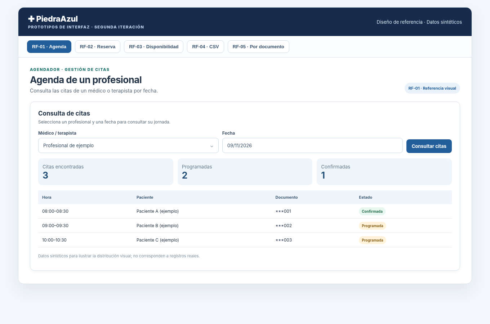
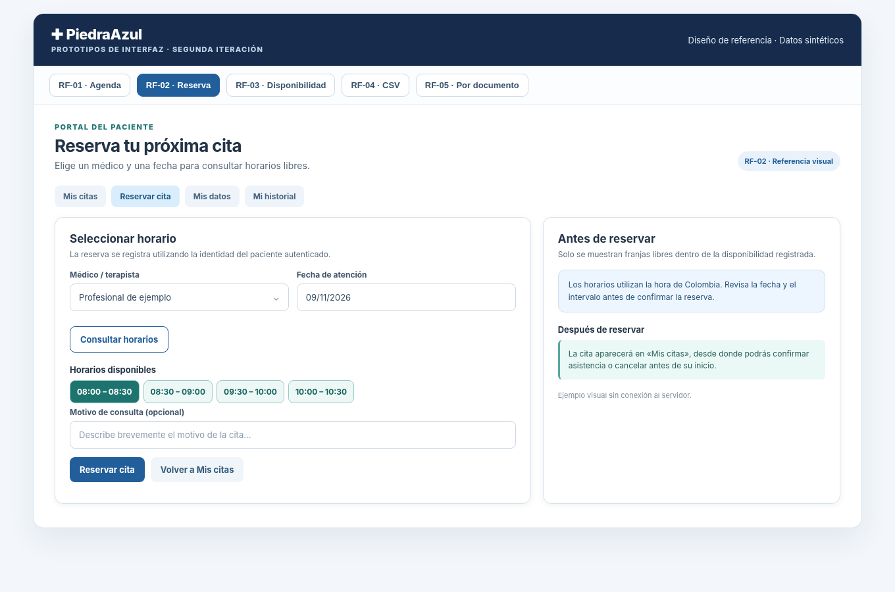
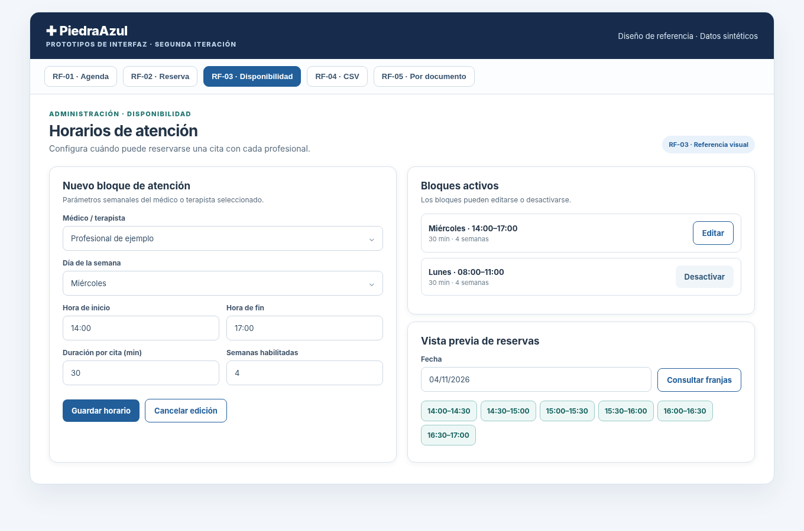
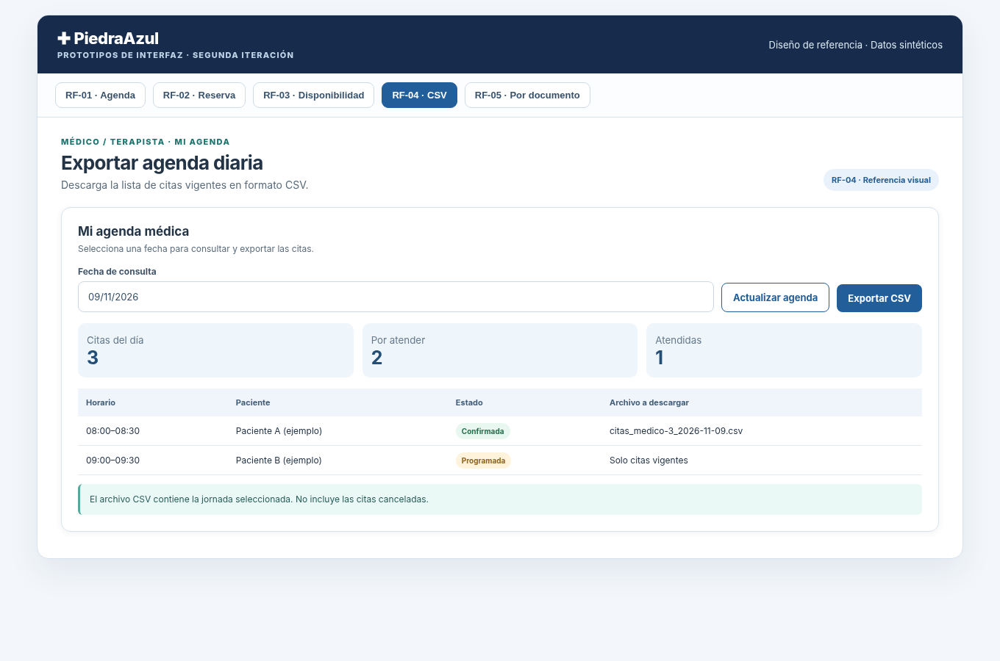
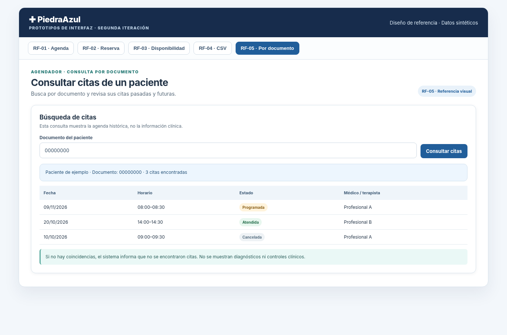

# ARCH-03 — Historias de usuario, prototipos y evaluación de usabilidad

**Proyecto:** Piedra Azul — sistema de reserva de citas médicas y terapéuticas  
**Asignatura:** Ingeniería de Software III · Segundo corte, 2026-2  
**Alcance:** segunda iteración del sistema  
**Propósito:** consolidar las historias funcionales exigidas, sus criterios de aceptación verificables, los prototipos de las interfaces y un protocolo reproducible de evaluación de usabilidad.

## 1. Alcance y enfoque

La segunda iteración se centra en facilitar la consulta y reserva de citas, configurar la disponibilidad de profesionales, exportar listados y consultar citas por documento. Las historias se redactan de acuerdo con los cinco requisitos funcionales del documento *Entregables Proyecto de Curso — Segundo Corte* (páginas 1 y 2). Los criterios de aceptación hacen explícitas las condiciones observables para cada historia.

Los prototipos anexos son **representaciones de referencia** elaboradas a partir de los componentes y flujos de interfaz del proyecto; se ilustran con datos ficticios y **no son capturas de una ejecución real**. El archivo `ARCH-03-prototipos.html` permite recorrer las cinco vistas sin conexión a servidores. Las imágenes de `prototipos/` facilitan su inclusión en el documento de arquitectura grupal.

Las verificaciones funcionales de software y las observaciones de una evaluación de usabilidad con participantes son evidencias distintas. La primera comprueba resultados técnicos; la segunda mide si usuarios representativos completan tareas con claridad y autonomía. No se presentan resultados de participantes que no hayan sido recogidos.

## 2. Historias de usuario y criterios de aceptación

### HU-01 — Consultar agenda por profesional y fecha (RF-01)

**Historia:** Como **agendador de citas**, necesito consultar las citas médicas de un médico o terapista en una fecha determinada para visualizar el listado y la cantidad de citas de la jornada.

**Criterios de aceptación:**

- **CA-01.1.** Dado un agendador autenticado, cuando selecciona un médico y una fecha válida y consulta, entonces obtiene las citas correspondientes exclusivamente a ese profesional y día.
- **CA-01.2.** El sistema muestra la **cantidad** de citas devueltas, coherente con el conjunto listado; los registros permiten identificar horario, paciente y estado.
- **CA-01.3.** Si la consulta no tiene resultados, el sistema comunica que no hay citas, sin presentar registros de otra fecha o profesional.
- **CA-01.4.** Una solicitud con fecha incorrecta o profesional inexistente recibe un mensaje apropiado; las consultas protegidas requieren permisos válidos.

**Referencia técnica:** `frontend/src/pages/citas/CitasPage.jsx`; `backend/src/modules/citas/application/cita.service.js`; `backend/src/modules/citas/infrastructure/cita.repository.js`. La lista del médico se consulta también en `frontend/src/pages/medicos/MedicoPage.jsx`.

### HU-02 — Reservar una cita de manera autónoma (RF-02)

**Historia:** Como **paciente**, necesito reservar una cita desde la web para obtener atención sin depender de WhatsApp y poder escoger un horario disponible de forma sencilla.

**Criterios de aceptación:**

- **CA-02.1.** Dado un paciente con sesión válida y perfil activo, cuando accede a «Reservar cita», puede seleccionar profesional y fecha y consultar las franjas disponibles.
- **CA-02.2.** Cuando elige una franja libre y confirma la reserva, el sistema registra la cita vinculada **al paciente autenticado**, muestra una confirmación y la incluye en «Mis citas».
- **CA-02.3.** Una franja ocupada no puede reservarse nuevamente; si se produce un conflicto concurrente, se notifica y el horario no se duplica.
- **CA-02.4.** Cuando no existen franjas en la fecha solicitada, se informa al usuario sin permitir guardar una cita sin horario.
- **CA-02.5.** El paciente puede consultar, confirmar y cancelar sus propias citas de acuerdo con las reglas de fecha y estado, sin gestionar citas de otros pacientes.

**Referencia técnica:** `frontend/src/pages/pacientes/PacientePage.jsx`; `backend/src/modules/citas/web/cita.routes.js`; `backend/src/modules/disponibilidad/application/disponibilidad.service.js`; `backend/src/modules/citas/infrastructure/cita.repository.js`.

### HU-03 — Configurar la disponibilidad de atención (RF-03)

**Historia:** Como **administrador**, necesito configurar la disponibilidad de médicos y terapistas para que las reservas autónomas respeten sus días, franjas, duración de citas y ventana temporal habilitada.

**Criterios de aceptación:**

- **CA-03.1.** El administrador puede seleccionar un profesional activo y registrar día de la semana, hora de inicio y fin, intervalo en minutos y semanas habilitadas.
- **CA-03.2.** El sistema rechaza intervalos o semanas no positivos, horarios invertidos, bloques que no permiten una cita completa y horarios solapados para el mismo profesional.
- **CA-03.3.** Al modificar un bloque existente, el cambio se refleja en la consulta y en la vista previa de las franjas.
- **CA-03.4.** Al desactivar un bloque, deja de ofrecerse para **nuevas reservas**, sin eliminar citas previamente registradas.
- **CA-03.5.** Los usuarios sin rol autorizado no pueden modificar los horarios administrativos.

**Referencia técnica:** `frontend/src/pages/admin/AdminPage.jsx`; `frontend/src/components/medicos/DisponibilidadMedico.jsx`; `backend/src/modules/disponibilidad/web/disponibilidad.routes.js`; `backend/src/modules/disponibilidad/infrastructure/disponibilidad.repository.js`.

### HU-04 — Exportar las citas de una jornada (RF-04)

**Historia:** Como **médico, terapista o agendador**, necesito exportar las citas correspondientes a un profesional y una fecha en formato CSV para organizar la jornada y facilitar su consulta desde una hoja de cálculo.

**Criterios de aceptación:**

- **CA-04.1.** Dado un usuario autorizado, cuando selecciona fecha y profesional según sus permisos y ejecuta «Exportar CSV», recibe un archivo descargable correspondiente a esa selección.
- **CA-04.2.** El contenido incluye columnas identificables de fecha, hora, documento, paciente y estado; es legible en un programa de hojas de cálculo.
- **CA-04.3.** La exportación de la jornada excluye las citas canceladas y conserva las vigentes según la regla funcional implementada.
- **CA-04.4.** Si no existen citas exportables, se obtiene un CSV válido con encabezados; si la fecha no es válida o se exceden los permisos, la operación presenta un error comprensible.
- **CA-04.5.** Un médico únicamente puede exportar su propia agenda.

**Referencia técnica:** `frontend/src/pages/medicos/MedicoPage.jsx`, `frontend/src/pages/citas/CitasPage.jsx`; `frontend/src/services/descarga-csv.js`; `backend/src/modules/citas/application/cita.service.js` (flujo de exportación CSV).

### HU-05 — Consultar citas de un paciente por cédula (RF-05)

**Historia:** Como **médico, terapista o agendador**, necesito buscar las citas de un paciente mediante su número de documento para conocer su historial de citas.

**Criterios de aceptación:**

- **CA-05.1.** El usuario autorizado introduce un documento y consulta las citas asociadas exclusivamente al paciente identificado.
- **CA-05.2.** Se presentan fecha, horario, profesional y estado para las citas encontradas, incluidas las anteriores y futuras de acuerdo con el registro.
- **CA-05.3.** Cuando no hay resultados, se informa claramente sin mostrar datos de otro paciente.
- **CA-05.4.** La interfaz no expone diagnósticos ni observaciones clínicas en el listado de citas.
- **CA-05.5.** La consulta requiere permisos válidos y restringe el acceso a otros roles.

**Referencia técnica:** `frontend/src/components/citas/ConsultaCitasPaciente.jsx`; `frontend/src/pages/citas/CitasPage.jsx`; endpoint `GET /api/historial/pacientes/{documento}/citas` implementado en el módulo de historial del flujo funcional correspondiente. Validar en la revisión grupal el alcance exacto por rol si el médico usa una ruta de interfaz distinta.

## 3. Estructura de navegación y decisiones de interfaz

Los prototipos representan cinco tareas agrupadas por rol:

| Rol | Sección / acción | Respuesta visible esperada |
|---|---|---|
| Agendador | Gestión de citas → filtros por médico y fecha | Listado, estado, horario y cantidad |
| Paciente | Reservar cita → médico → fecha → horario | Franjas disponibles, confirmación y acceso a «Mis citas» |
| Administrador | Disponibilidad → profesional → crear/editar/desactivar | Bloques activos y vista previa de horarios |
| Médico / agendador | Agenda → seleccionar jornada → Exportar CSV | Descarga de archivo de jornada |
| Médico / agendador | Consultar citas por documento | Tabla cronológica de citas, sin información clínica |

Se prioriza mantener acciones reconocibles, mensajes de vacío/error, confirmaciones de operaciones sensibles y consistencia de nombres. Las pantallas adaptan sus opciones al rol de la sesión. Los prototipos son material de apoyo: la evidencia de funcionamiento debe obtenerse desde la aplicación real.

## 4. Protocolo del test de evaluación de usabilidad

### 4.1 Propósito

Evaluar si usuarios representativos identifican la sección adecuada, completan una tarea sin indicaciones técnicas y entienden los mensajes del sistema. El foco principal es **agenda y reserva**, conforme a ARCH-03; disponibilidad, exportación y consulta complementan el recorrido.

### 4.2 Participantes y condiciones

Se propone reclutar entre **3 y 5 participantes** adultos que representen, cuando sea posible, los roles paciente, agendador y administrador. Registrar una experiencia previa general con sistemas de citas (baja/media/alta), sin guardar datos médicos ni números de documento reales. Una misma persona puede ejecutar tareas con cuentas ficticias de prueba de distintos roles; esto debe anotarse como una limitación de representatividad.

Se utiliza una versión funcional de Piedra Azul, base de datos de ensayo y cuentas sintéticas con los roles necesarios. El moderador observa sin guiar la ejecución. El test puede realizarse presencialmente o por videollamada, previa autorización.

**Consentimiento breve sugerido:** «Participarás en una evaluación de la facilidad de uso de un sistema de citas. Se registrarán tiempos, dificultades y comentarios sobre la interfaz, no datos personales ni clínicos. Puedes interrumpir la sesión cuando quieras. ¿Aceptas participar?»

### 4.3 Tareas para el participante

| Tarea | Contexto que se entrega sin explicar los clics | Criterio observable de éxito | Tiempo objetivo propuesto* |
|---|---|---|---:|
| T1 · RF-02 | «Necesitas reservar una cita para la próxima semana con un médico que tenga disponibilidad». | Selecciona profesional, fecha y franja; reserva; identifica la confirmación en «Mis citas». | ≤ 3 min |
| T2 · RF-01 | «Debes conocer cuántas citas tiene un profesional el día indicado». | Encuentra filtro y obtiene cantidad/listado correctos. | ≤ 2 min |
| T3 · RF-03 | «Debes programar atención el miércoles entre las 14:00 y las 17:00, con citas de 30 minutos, por 4 semanas». | Configura bloque válido y verifica franjas; se utiliza profesional de prueba. | ≤ 4 min |
| T4 · RF-04 | «Necesitas llevar a una hoja de cálculo la jornada del profesional seleccionado». | Inicia exportación e identifica archivo CSV descargado. | ≤ 2 min |
| T5 · RF-05 | «Consulta las citas anteriores y futuras de un paciente usando su documento de prueba». | Obtiene la lista correcta e interpreta fecha y estado. | ≤ 2 min |

*Los tiempos son **umbrales de evaluación propuestos, no mediciones realizadas**. Si el entorno de prueba no dispone de datos o permisos para una tarea, debe registrarse como no evaluada; no marcarla como exitosa.

### 4.4 Secuencia de sesión

1. Explicar objetivo y solicitar consentimiento.
2. Registrar perfil anónimo (P01, P02…), rol usado y experiencia previa.
3. Presentar una tarea a la vez, leyendo su objetivo sin indicar dónde hacer clic.
4. Registrar hora de inicio y final, acciones observadas, errores, dudas, ayudas solicitadas y cumplimiento.
5. Pedir al participante valorar claridad de navegación y mensajes en una escala de 1 (muy difícil) a 5 (muy fácil) y recoger un comentario libre.
6. Cerrar la sesión, agradecer la participación y dejar el entorno de prueba sin reservas temporales activas si corresponde.

### 4.5 Indicadores, cálculo e interpretación

| Indicador | Definición | Evidencia requerida |
|---|---|---|
| Tasa de éxito por tarea | Tareas realizadas correctamente sin ayuda / tareas válidamente intentadas × 100 | Resultado por participante y tarea |
| Tiempo de finalización | Segundos desde que comienza la tarea hasta confirmación o abandono | Inicio y fin anotados |
| Errores observables | Acciones que generan validación, regresión, clic equivocado o intento de una opción incorrecta | Observación y número de errores |
| Ayudas requeridas | Número de intervenciones del moderador | Registro de ayudas |
| Claridad percibida | Escala de 1 a 5 respondida por el participante | Calificación y comentario |

Las incidencias se agrupan por severidad: **alta** (impide completar), **media** (complica o retrasa considerablemente) y **baja** (detalle menor que no bloquea). Para cada hallazgo se recomienda registrar pantalla, paso, efecto, mejora y prioridad.

### 4.6 Ficha de observación individual (duplicar por participante)

| Campo | Registro |
|---|---|
| Participante anónimo | P__ |
| Fecha y dispositivo | ____ |
| Consentimiento | Sí / No |
| Rol de la tarea | ____ |
| Tarea | T__ |
| Éxito sin ayuda | Sí / No / No evaluada |
| Tiempo real | ____ segundos |
| Errores observados | ____ |
| Ayudas del moderador | ____ |
| Claridad percibida (1–5) | ____ |
| Observaciones / cita breve | ____ |

### 4.7 Consolidado y acciones de mejora

| Tarea | Participantes válidos | Éxito sin ayuda | Tiempo mediano | Incidencias | Mejora priorizada |
|---|---|---|---|---|---|
| RF-02 · Reserva | — | — | — | — | — |
| RF-01 · Agenda | — | — | — | — | — |
| RF-03 · Disponibilidad | — | — | — | — | — |
| RF-04 · CSV | — | — | — | — | — |
| RF-05 · Documento | — | — | — | — | — |

**Registro de resultados:** completar esta tabla únicamente con los datos obtenidos en las sesiones efectivamente realizadas. Las celdas «—» no equivalen a aprobación ni a incumplimiento; indican ausencia de medición registrada en este documento.

### 4.8 Revisión de usabilidad de los prototipos

**Tipo de evaluación:** inspección de las cinco pantallas estáticas diseñadas para RF-01 a RF-05. Se revisaron la claridad de las tareas, el orden de los controles, la visibilidad de resultados y la orientación que recibe el usuario. **No se ejecutaron tareas con participantes ni se midieron tiempos de interacción.** Por esta razón, esta revisión complementa el protocolo anterior, pero no reemplaza el test con usuarios.

| Pantalla revisada | Aspectos observados | Mejora identificada | Prioridad |
|---|---|---|---|
| RF-01 · Agenda | Los filtros de profesional y fecha están juntos; el número de citas aparece antes del listado y cada fila presenta horario, paciente y estado. | Incluir un estado vacío visible cuando no existan citas y mostrar un mensaje junto al filtro si la fecha no es válida. | Media |
| RF-02 · Reserva | El recorrido presenta profesional, fecha, franjas disponibles y el botón «Reservar cita»; la sección «Antes de reservar» explica condiciones básicas. | Hacer más evidente cuál horario está seleccionado y mantener visible la confirmación o el motivo de un error al reservar. | Alta |
| RF-03 · Disponibilidad | Los campos de días, horas, duración y semanas aparecen agrupados; se muestra una vista previa de franjas y bloques activos. | Confirmar visualmente el guardado y diferenciar con claridad la edición de un bloque existente de la creación de uno nuevo. | Media |
| RF-04 · Exportación CSV | La fecha y el botón de exportación son fáciles de identificar; un resumen de la jornada precede al listado de citas. | Mostrar una notificación cuando la descarga termine y un aviso claro si no hay citas para exportar. | Baja |
| RF-05 · Consulta por documento | La búsqueda aparece antes de los resultados; el listado permite reconocer fechas, horarios y estados, sin presentar información clínica. | Añadir ejemplos de mensaje para documento inválido y búsqueda sin coincidencias, sin mostrar información de otros pacientes. | Media |

**Resultado de la revisión:** las pantallas presentan una secuencia de tareas comprensible y controles agrupados por función. Las mejoras propuestas se concentran en la selección de horarios, los mensajes de confirmación, las validaciones y los estados sin resultados. Son observaciones sobre los **prototipos**, no afirmaciones de errores comprobados en la aplicación en funcionamiento.

**Alcance:** cinco prototipos examinados; cero participantes y cero tareas de usuario medidas. No se reportan tasa de éxito, tiempo promedio, satisfacción ni puntuaciones de usuarios, porque esos datos requieren sesiones efectivas. Las observaciones pueden utilizarse para orientar ajustes de interfaz y para priorizar las tareas de un test posterior.

## 5. Verificaciones funcionales disponibles y límite de interpretación

En la evidencia técnica del proyecto se registraron comprobaciones de los flujos RF-02 y RF-03, que sirven de contexto para escoger tareas realistas de usabilidad:

- **RF-02:** comprobación de acceso del paciente, consulta de franjas, reserva propia, confirmación, cancelación y devolución de la franja al conjunto disponible. Se registraron **11 pruebas automatizadas aprobadas** para los conjuntos ejecutados.
- **RF-03:** comprobación manual de creación, edición, vista previa y desactivación de disponibilidad. La vista previa mostró seis franjas de treinta minutos en el bloque de ejemplo; también constan pruebas automatizadas específicas y verificación API/base de datos.

**Estas comprobaciones no se presentan como test de usabilidad con participantes.** La percepción de uso, los tiempos de finalización y los hallazgos de participantes requieren el protocolo y los registros del apartado 4.

## 6. Material que se incorpora al documento grupal de arquitectura

El apartado de ARCH-03 permite insertar en el documento de ARCH-04 las cinco historias con criterios de aceptación, cinco prototipos gráficos y el resumen del test de usabilidad **cuando se haya ejecutado**. La evaluación visual debe mostrar pantallas legibles; las capturas de prototipos se acompañan de capturas de la aplicación real cuando estén disponibles.

**Referencias principales:** documento del profesor *EntregablesSegundoCorte2026.2-IngSoft3(1).pdf* (págs. 1–4); [Issue ARCH-03 #24](https://github.com/gvalen03/piedra-azul/issues/24); código de `frontend/src` y `backend/src` de Piedra Azul, junto con las evidencias funcionales RF-02/RF-03 registradas en el repositorio.
